| Informasi | Keterangan |
|---|---|
| Tanggal | 15 Oktober 2026 |
| Disusun oleh | Rizqi Satria Andhika Gusni, S.Kom – Pranata Komputer Ahli Pertama Icsa Alif Algiffari Yunus, SKM - Promkes |
| Instansi | Balai Laboratorium Kesehatan Masyarakat Ambon |
| Kondisi saat ini | Pelacakan sampel SICAKEP BIEON berbasis Google Looker Studio dan Google Spreadsheet; pelanggan mencari progres menggunakan nomor FPPS dan dapat mengunduh bukti progres. |
| Tujuan pengembangan | Aplikasi web terintegrasi yang mengelola proses dari pendaftaran/pencatatan permohonan sampai penerimaan sampel, pengujian, validasi, penerbitan, pelacakan, dan penyerahan LHU. |

# 1. Ringkasan Singkat

Aplikasi Sistem Informasi Laboratorium Balai Labkesmas Ambon akan dibangun dari awal (created from scratch) sebagai aplikasi web mandiri dan tidak mengambil data atau bergantung pada SICAKEP BIEON/Google Looker Studio yang sudah ada. Aplikasi baru mengelola seluruh proses layanan mulai dari pendaftaran, penerimaan sampel, pengujian, validasi, penerbitan Laporan Hasil Uji (LHU), pelacakan status, hingga pengunduhan dan pencetakan LHU oleh pelanggan.

Sistem diharapkan memudahkan petugas mengelola data dalam satu alur, membantu pimpinan memantau antrean dan waktu penyelesaian, serta menjaga kerahasiaan data dan LHU. Estimasi waktu penyelesaian harus dapat dikonfigurasi setelah Balai menetapkan acuan resmi karena materi yang tersedia mencantumkan estimasi yang berbeda.

# 2. Siapa Saja Pengguna Sistem

| **Peran**                 | **Contoh pengguna**                                                     | **Bisa melakukan apa**                                                                                                                                                                    |
|-----------------|------------------|--------------------------------------|
| Administrator             | Pranata Komputer/pengelola aplikasi                                     | Mengatur akun dan hak akses, katalog layanan, parameter, tarif, template LHU, konfigurasi, serta melihat log aktivitas.                                                                   |
| Petugas Pelayanan         | Petugas pelayanan/administrasi                                          | Mencatat atau memeriksa pendaftaran, mengelola data pemohon, mengecek kelengkapan, mencatat status pembayaran sesuai kewenangan, dan menyiapkan penyerahan hasil.                         |
| Petugas Penerimaan Sampel | Petugas yang ditugaskan menerima sampel                                 | Memeriksa kondisi dan persyaratan sampel, lalu mencatat sampel diterima atau ditolak beserta alasan. Peran ini dapat digabung dengan Petugas Pelayanan bila sesuai pembagian kerja Balai. |
| Petugas Laboratorium      | Analis/staf laboratorium dan Kepala Instalasi/validator yang ditetapkan | Melihat pekerjaan, menginput dan mengedit hasil, mengirim hasil untuk validasi, memvalidasi atau mengembalikan hasil sesuai kewenangan.                                                   |
| Pimpinan                  | Kepala Balai/pimpinan yang diberi akses                                 | Melihat dashboard, antrean, statistik layanan, waktu penyelesaian, dan laporan. Secara default tidak mengubah hasil pemeriksaan.                                                          |
| Pelanggan/Pemohon Uji     | Masyarakat, fasilitas kesehatan, instansi, atau pemohon layanan         | Mengajukan pendaftaran online jika fitur diaktifkan, atau tetap melalui WhatsApp dengan dibantu petugas; melacak status dan mengunduh LHU setelah hak akses diverifikasi.                 |

Aplikasi dibangun sebagai sistem baru yang mandiri, bukan pengembangan atau migrasi dari Looker Studio lama. Pelanggan dapat mengajukan permohonan melalui formulir online. Untuk pelanggan yang masih mendaftar melalui WhatsApp, petugas pelayanan dapat memasukkan permohonan ke aplikasi agar semua proses tetap tercatat dalam satu sistem.

# 3. Layanan yang Ingin Dibuat Sistemnya

Setiap layanan di bawah menjadi modul/menu aplikasi. Semua parameter, tarif, syarat sampel, dan estimasi harus bisa dikelola oleh petugas berwenang. Kategori dan contoh parameter berikut mengikuti brosur yang diberikan; tarif yang tercantum berdasarkan tarif tahun 2025 dan harus diverifikasi terhadap tarif resmi yang berlaku kedepannya sebelum dimasukkan sebagai data produksi.

## Layanan A --- Pendaftaran Online Sampel dan Katalog Pemeriksaan

**a) Langkah-langkah:**

1.  Pelanggan memilih kelompok layanan/paket pemeriksaan, mengisi identitas pemohon/instansi, kontak, tujuan pemeriksaan, informasi sampel, lokasi dan tanggal pengambilan bila relevan, serta dokumen pendukung yang dibutuhkan.

2.  Sistem membuat nomor permohonan dan nomor FPPS sesuai aturan penomoran yang ditetapkan Balai. Nomor FPPS menjadi identitas yang digunakan pelanggan untuk melacak status dan mengakses LHU bersama verifikasi nomor HP.

3.  Petugas memeriksa kelengkapan dan mengonfirmasi persyaratan, biaya, pembayaran, serta cara pengiriman/penyerahan sampel.

4.  Pelanggan menerima informasi nomor permohonan/FPPS untuk pelacakan.

**Data yang disimpan: nomor permohonan/FPPS, tanggal, nama pelanggan dan instansi, nomor HP dan kontak lain yang diperlukan, layanan/paket, parameter yang diminta, identitas dan jenis sampel, lokasi/tanggal sampling bila relevan, jumlah/volume, dokumen pendukung, catatan, kanal pendaftaran, status pembayaran bila berlaku, dan status permohonan.**

**Aturan khusus: kolom wajib divalidasi; nomor permohonan/FPPS tidak boleh duplikat; tarif, parameter, dan persyaratan harus mengikuti master resmi; perubahan katalog tidak mengubah permohonan lama; data pelanggan harus dilindungi dan hanya dapat diakses sesuai hak akses.**

**Kelompok layanan pada brosur**

| **Kelompok layanan**                         | **Contoh parameter/jenis pemeriksaan pada brosur**                                                    | **Total/pilihan yang terlihat\***         |
|---------------|------------------------------------------|---------------|
| Air Laut                                     | Suhu, TDS/TSS, warna, pH, BOD, COD, DO, logam, deterjen, coliform.                                    | Rp484.000\*                               |
| Air Limbah Domestik                          | pH, BOD, amoniak, COD, TSS, total coliform.                                                           | Rp169.000\*                               |
| Air Limbah Faskes                            | TDS, MBAS, NH3-N, Pb, Fe, Mn, Cu, Zn, Cd, dan parameter lain.                                         | Rp373.000\*                               |
| Vektor                                       | Lalat, tikus, nyamuk, kecoa.                                                                          | Rp100.000\*                               |
| Makanan                                      | Boraks, formalin, rhodamin, methyl yellow, angka kuman, coliform, Salmonella, Vibrio.                 | Rp680.000\*                               |
| Swab Alat                                    | Angka kuman, coliform, E. coli.                                                                       | Rp228.000\*                               |
| Air Bersih                                   | Suhu, kekeruhan, TDS, pH, besi, mangan, kromium, coliform, E. coli.                                   | Rp343.000\*                               |
| Air Sungai                                   | Suhu, TDS/TSS, pH, BOD, COD, DO, fosfat, logam, deterjen, coliform.                                   | Rp708.000\*                               |
| Air Kolam Renang                             | Bau, kekeruhan, suhu, pH, alkalinitas, sisa klor, HPC/angka kuman.                                    | Rp103.000\*                               |
| Bakteriologi Udara                           | Angka kuman.                                                                                          | Rp60.000\*                                |
| Udara Ambien                                 | Kebisingan, suhu, kelembapan, tekanan, NO2, SO2, NH3, O3, angin, TSP 24 jam.                          | Rp734.000\*                               |
| Udara Ruangan                                | Kebisingan, suhu, kelembapan, pencahayaan.                                                            | Rp54.000\*                                |
| Patologi Klinis                              | Kolesterol total, asam urat, gula darah.                                                              | Rp90.000\*                                |
| Air Minum                                    | Bau, kekeruhan, warna, TDS, pH, nitrit/nitrat, logam, coliform, E. coli.                              | Rp503.000\*                               |
| Penelitian                                   | Pilihan pada brosur: Studi D3, Studi S1, Studi S2.                                                    | D3 Rp80.000; S1 Rp120.000; S2 Rp500.000\* |
| Mikrobiologi, Parasitologi, dan Biomolekuler | Influenza, sequencing SARS-CoV-2, serologi, TB, difteri, pertusis, malaria, filariasis, telur cacing. | Rp2.229.000\*                             |
| Kalibrasi                                    | Photometer, inkubator, konduktometer, pH meter.                                                       | Rp1.244.000\*                             |

\*Nilai merupakan angka yang terlihat pada brosur yang diberikan, bukan konfirmasi tarif resmi atau tarif setiap pilihan parameter secara individual. Administrator harus memasukkan paket, komponen tarif, dan tanggal berlaku berdasarkan daftar tarif yang telah disahkan. Parameter di atas adalah contoh ringkas; katalog operasional harus mengikuti daftar resmi lengkap.

## Layanan B --- Penerimaan Sampel (Terima/Tolak)

**a) Langkah-langkah:**

> 1\. Petugas membuka permohonan berdasarkan nomor permohonan/FPPS dan mencocokkan identitas serta jenis sampel yang diserahkan.
>
> 2\. Petugas memeriksa label, jumlah/volume, wadah, kondisi, waktu pengambilan, dan persyaratan khusus sesuai jenis sampel.
>
> 3\. Petugas memilih status "Diterima" atau "Ditolak". Jika ditolak, alasan dan tindak lanjut wajib dicatat.
>
> 4\. Jika diterima, sistem mencatat tanggal/waktu penerimaan dan melanjutkan sampel ke antrean pengujian.

**b) Data yang disimpan:** Nomor FPPS, kode/jenis sampel, waktu diterima, jumlah/volume, kondisi, petugas, keputusan, dan alasan penolakan.

**c) Aturan khusus:** Sampel ditolak tidak dapat masuk proses uji. Syarat volume/wadah mengikuti katalog tiap jenis sampel, dan semua keputusan tercatat dengan pengguna serta waktu.

## Layanan C --- Pengujian Sampel (Input, Edit, dan Validasi Hasil)

**a) Langkah-langkah:**

> 1\. Sistem menampilkan daftar pekerjaan yang sudah diterima dan ditugaskan ke petugas/instalasi terkait.
>
> 2\. Analis menginput hasil untuk setiap parameter yang dipesan, termasuk nilai/teks hasil, satuan, metode, tanggal pengujian, dan catatan jika diperlukan.
>
> 3\. Analis menyimpan hasil sebagai draf dan mengirimkannya ke Validasi Manager Lab.
>
> 4\. Validator memeriksa hasil, lalu menyetujui atau mengembalikannya kepada analis dengan catatan koreksi. Setelah tahap ini selesai, hasil menjalani Validasi Rekomendasi apabila diwajibkan oleh alur Balai.
>
> 5\. Jika dikembalikan, analis memperbaiki hasil dan mengirim ulang. Sistem menyimpan riwayat perubahan.

**b) Data yang disimpan:** Nomor pekerjaan, kode sampel, layanan dan parameter, analis/petugas, hasil, satuan, metode, tanggal uji, catatan, status validasi, nama validator, tanggal keputusan, dan riwayat revisi.

**c) Aturan khusus:** Hasil tidak boleh diterbitkan sebagai LHU final sebelum seluruh validasi wajib selesai. Perubahan hasil yang sudah divalidasi harus melalui mekanisme koreksi dengan alasan dan jejak audit; tipe hasil dapat berupa angka atau teks sesuai parameternya.

## Layanan D --- Pembuatan Laporan Hasil Uji (LHU)

**a) Langkah-langkah:**

> 1\. Setelah validasi selesai, petugas berwenang membuat LHU dari template resmi Balai Labkesmas Ambon.
>
> 2\. Sistem mengisi data pemohon, nomor LHU, jenis/kode sampel, tanggal penerimaan dan pengujian, serta tabel hasil sesuai parameter yang diperiksa.
>
> 3\. Petugas memeriksa tampilan LHU, lalu menerbitkan versi final sesuai kewenangan yang ditetapkan.
>
> 4\. LHU final disimpan sebagai PDF terkontrol dan terhubung dengan nomor FPPS/permohonan.

**Data yang disimpan: nomor LHU, nomor FPPS, kontak pelanggan (nomor HP, nama pelanggan, dan informasi lain yang diperlukan), jenis sampel, kode sampel, tanggal terima, tanggal uji, tanggal validasi, serta uraian yang memuat nama sampel, nomor sampel, parameter, satuan, hasil uji, metode pengujian, dan limit/ambang batas parameter jika ada. LHU juga memuat pertimbangan hasil, verifikator hasil, dan validator hasil.**

**Aturan khusus: gunakan format LHU yang ditetapkan Balai. Hasil, metode, limit/ambang batas, pertimbangan, verifikator, dan validator harus berasal dari data yang sah serta divalidasi. LHU tidak boleh menjadi final sebelum validasi selesai; revisi harus menghasilkan versi baru dan riwayat perubahan.**

## Layanan E --- Lacak Status Sampel dan Unduh Hasil Uji

**a) Langkah-langkah:**

1.  Pelanggan membuka menu Lacak Sampel dan memasukkan nomor FPPS untuk melihat status/progres permohonan.

2.  Sistem menampilkan status dan informasi progres yang terkait dengan nomor FPPS, termasuk estimasi penyelesaian jika sudah ditetapkan. Halaman ini tidak menampilkan hasil rinci yang bersifat rahasia.

3.  Jika LHU telah terbit dan berstatus final, pelanggan memasukkan nomor FPPS serta nomor HP yang tercatat pada permohonan. Sistem memeriksa kecocokan kedua data sebelum mengizinkan pengunduhan LHU.

4.  Pelanggan dapat mengunduh bukti progres sampel dan LHU final setelah verifikasi berhasil. Petugas juga dapat mencetak atau menyerahkan hasil sesuai kewenangan dan prosedur Balai.

**Data yang disimpan: nomor FPPS, status terkini, riwayat perubahan status, estimasi penyelesaian, waktu pembaruan, status LHU, nomor HP pelanggan untuk pencocokan (disimpan dengan perlindungan yang sesuai), catatan penyerahan, dan log akses/unduhan dokumen.**

**Aturan khusus: aplikasi pelacakan dan unduh hasil merupakan bagian dari aplikasi baru, bukan mengambil data dari SICAKEP BIEON/Looker Studio lama. Status pelanggan hanya menampilkan informasi yang diizinkan. LHU tidak boleh tersedia melalui tautan publik permanen; unduhan memerlukan kecocokan nomor FPPS dan nomor HP serta status LHU final/tervalidasi.**

## Layanan F --- Cetak Hasil Uji

**a) Langkah-langkah:** Petugas yang berwenang membuka LHU final, meninjau dokumen, lalu memilih cetak atau mengunduh PDF untuk dicetak. Pelanggan dapat mencetak PDF yang berhasil diunduh setelah hak aksesnya diverifikasi.

**b) Data yang disimpan:** Nomor LHU, versi dokumen, waktu cetak/unduh jika dicatat, pengguna yang melakukan tindakan, dan status penyerahan jika berkaitan.

**c) Aturan khusus:** Dokumen yang dicetak harus sama dengan versi final tersimpan, lengkap dengan nomor dokumen, halaman, dan pengesahan yang berlaku. Draf tidak diberi tampilan seolah-olah LHU final.

# 4. Laporan & Dashboard yang Dibutuhkan

Dashboard menampilkan ringkasan sesuai peran. Laporan bisa difilter berdasarkan tanggal/periode, kelompok layanan, status, unit/instalasi, dan pemohon sesuai hak akses; laporan operasional dapat diekspor ke PDF atau Excel.

| **Dashboard/laporan**               | **Informasi yang dibutuhkan**                                                                                                                                                                                                                                                                   |
|--------------------|----------------------------------------------------|
| Dashboard Petugas Pelayanan         | Jumlah permohonan baru; menunggu kelengkapan; menunggu pembayaran; menunggu penerimaan sampel; sampel diterima/ditolak; hasil yang siap diserahkan.                                                                                                                                             |
| Dashboard Laboratorium              | Jumlah pekerjaan per kelompok layanan/instalasi; sedang diuji; menunggu Validasi Manager Lab; menunggu Validasi Rekomendasi; hasil dikembalikan untuk perbaikan; pekerjaan melewati estimasi.                                                                                                   |
| Dashboard Pimpinan                  | Total permohonan dan sampel per periode; distribusi layanan; jumlah selesai dan tertunda; waktu penyelesaian; persentase yang selesai sesuai estimasi; LHU terbit dan sudah diserahkan. Tampilan ringkasan tidak perlu memunculkan data pribadi/hasil klinis yang tidak diperlukan.             |
| Rekap permohonan dan sampel         | Nomor FPPS, tanggal, jenis layanan/sampel, status penerimaan, status proses, dan unit yang menangani. Data pribadi hanya ditampilkan sesuai kewenangan.                                                                                                                                         |
| Rekap per jenis layanan pada brosur | Jumlah permohonan untuk Air Laut, Air Limbah Domestik, Air Limbah Faskes, Vektor, Makanan, Swab Alat, Air Bersih, Air Sungai, Air Kolam Renang, Bakteriologi Udara, Udara Ambien, Udara Ruangan, Patologi Klinis, Air Minum, Penelitian, Mikrobiologi/Parasitologi/Biomolekuler, dan Kalibrasi. |
| Rekap waktu penyelesaian            | Tanggal pembayaran/registrasi, penerimaan sampel, mulai atau proses pengujian, validasi selesai, LHU terbit, penyerahan; durasi proses dan sampel yang melewati estimasi.                                                                                                                       |
| Rekap LHU                           | Nomor LHU, nomor FPPS, layanan, tanggal terbit, versi/revisi, dan status penyerahan. Detail hasil hanya untuk pengguna berwenang.                                                                                                                                                               |
| Rekap penerimaan sampel             | Jumlah diterima/ditolak, alasan penolakan, kategori sampel, tanggal penerimaan, dan tindak lanjut.                                                                                                                                                                                              |
| Laporan unduh/cetak                 | Bukti progres sampel, LHU final per permohonan, serta rekap harian/bulanan/tahunan dalam PDF/Excel sesuai hak akses.                                                                                                                                                                            |

Catatan estimasi: brosur yang dilampirkan menyebut estimasi penyelesaian 10 hari kalender sejak tanggal penerimaan dan registrasi pembayaran, sedangkan tampilan pelacakan sebelumnya menyebut 8 hari kalender dari pembayaran. Administrator tidak boleh menetapkan salah satu secara permanen sebelum pemilik layanan mengonfirmasi durasi, titik awal perhitungan, dan kemungkinan perbedaan berdasarkan jenis pemeriksaan.

# 5. Catatan untuk AI Coding Assistant

*Bagian ini boleh dibiarkan seperti apa adanya --- ini \"instruksi teknis\" otomatis untuk AI, bukan sesuatu yang perlu Anda tulis ulang.*

-   Tiap Layanan di Bagian 3 → jadi satu modul/menu di sistem

-   Tiap langkah alur → jadi status transaksi (contoh: Menunggu → Dikonfirmasi → Lunas → Selesai)

-   Tiap data yang dicatat → jadi kolom di database

-   Tiap aturan bisnis → jadi validasi otomatis di sistem

-   Bagian 4 → jadi tampilan dashboard + tombol ekspor PDF/Excel

# 6. Desain Basis Data

Lampiran teknis hasil turunan dari PRD di atas: ER diagram dan deskripsi tabel. Konvensi Laravel: nama tabel plural snake_case bahasa Inggris. Pegawai (`employees`) login di dashboard internal dengan RBAC spatie/laravel-permission (guard `employee`); pelanggan (`customers`) adalah tabel terpisah yang login di web frontend tanpa RBAC.

## 6.1 ER Diagram

Diagram ditulis dalam sintaks Mermaid (dapat dirender di GitHub, GitLab, VS Code, Obsidian, dan mermaid.live).

```mermaid
erDiagram
    employees ||--o{ model_has_roles : "model (polymorphic)"
    roles ||--o{ model_has_roles : assigned
    employees ||--o{ model_has_permissions : "model (polymorphic)"
    permissions ||--o{ model_has_permissions : "direct permission"
    roles ||--o{ role_has_permissions : has
    permissions ||--o{ role_has_permissions : "in role"
    laboratory_units ||--o{ employees : "penempatan"

    service_groups ||--o{ test_parameters : has
    service_groups ||--o{ service_packages : has
    service_groups ||--o{ sample_types : has
    service_groups ||--o{ tariffs : priced_by
    service_groups ||--o{ completion_estimates : configured_by
    service_packages ||--o{ package_parameters : contains
    test_parameters ||--o{ package_parameters : in
    service_packages ||--o{ tariffs : priced_by
    test_parameters ||--o{ tariffs : priced_by
    laboratory_units ||--o{ service_groups : handles

    customers ||--o{ test_requests : submits
    service_groups ||--o{ test_requests : categorized
    service_packages |o--o{ test_requests : chosen
    employees ||--o{ test_requests : "created_by"
    test_requests ||--o{ test_request_documents : attaches
    test_requests ||--o{ test_request_parameters : orders
    test_parameters ||--o{ test_request_parameters : ordered
    test_requests ||--o{ payments : paid_by
    employees ||--o{ payments : "recorded_by"
    test_requests ||--o{ status_histories : tracks
    employees ||--o{ status_histories : "changed_by"

    test_requests ||--o{ samples : contains
    sample_types ||--o{ samples : typed
    samples ||--o{ sample_receipts : checked
    employees ||--o{ sample_receipts : "received_by"

    samples ||--o{ test_jobs : tested_in
    laboratory_units ||--o{ test_jobs : processes
    employees ||--o{ test_jobs : "assigned_to"
    test_jobs ||--o{ test_results : produces
    test_request_parameters ||--o{ test_results : measured
    employees ||--o{ test_results : "analyst_id"
    test_results ||--o{ result_validations : validated_by
    employees ||--o{ result_validations : "validator_id"
    test_results ||--o{ result_revisions : revised
    employees ||--o{ result_revisions : "revised_by"

    report_templates ||--o{ test_reports : formats
    test_requests ||--o{ test_reports : yields
    test_reports ||--o{ test_reports : "revision of"
    employees ||--o{ test_reports : "verifier / validator / issuer"
    test_reports ||--o{ test_report_items : lists
    test_results ||--o{ test_report_items : sourced_from
    test_reports ||--o{ report_handovers : handed_over
    test_reports ||--o{ document_access_logs : logged
    customers |o--o{ document_access_logs : accessed_by
    employees |o--o{ document_access_logs : accessed_by
    employees |o--o{ activity_logs : "causer (polymorphic)"
    customers |o--o{ activity_logs : "causer (polymorphic)"

    roles { bigint id PK
        string name "UK with guard_name"
        string guard_name "employee"
        timestamps timestamps }
    permissions { bigint id PK
        string name "UK with guard_name"
        string guard_name "employee"
        timestamps timestamps }
    model_has_roles { bigint role_id FK
        string model_type "App-Models-Employee"
        bigint model_id }
    model_has_permissions { bigint permission_id FK
        string model_type "App-Models-Employee"
        bigint model_id }
    role_has_permissions { bigint permission_id FK
        bigint role_id FK }
    employees { bigint id PK
        bigint laboratory_unit_id FK
        string name
        string email UK
        string phone
        string nip UK
        string password
        boolean is_active
        timestamp last_login_at
        string remember_token
        timestamps timestamps }
    customers { bigint id PK
        string name
        string organization_name
        string customer_type
        string email UK "nullable"
        string phone "encrypted"
        string phone_hash "index"
        text address
        string password "nullable, login frontend"
        timestamp email_verified_at
        string remember_token
        timestamps timestamps }
    laboratory_units { bigint id PK
        string name
        string code UK }
    service_groups { bigint id PK
        bigint laboratory_unit_id FK
        string code UK
        string name
        text description
        boolean is_active }
    service_packages { bigint id PK
        bigint service_group_id FK
        string name
        boolean is_active }
    test_parameters { bigint id PK
        bigint service_group_id FK
        string name
        string unit
        string method
        string result_type "numeric|text"
        decimal threshold_min
        decimal threshold_max
        string threshold_text
        boolean is_active }
    package_parameters { bigint service_package_id FK
        bigint test_parameter_id FK }
    tariffs { bigint id PK
        bigint service_group_id FK
        bigint service_package_id FK
        bigint test_parameter_id FK
        decimal amount
        date effective_from
        date effective_until }
    completion_estimates { bigint id PK
        bigint service_group_id FK
        int days
        string start_point "payment|receipt"
        date effective_from }
    sample_types { bigint id PK
        bigint service_group_id FK
        string name
        decimal min_volume
        string container_requirement
        text requirements }

    test_requests { bigint id PK
        string request_number UK
        string fpps_number UK
        bigint customer_id FK
        bigint service_group_id FK
        bigint service_package_id FK
        bigint created_by FK
        string purpose
        string channel "online|whatsapp|counter"
        string sampling_location
        date sampling_date
        text notes
        decimal total_amount
        string payment_status
        string status
        date estimated_completion_date
        timestamp registered_at }
    test_request_documents { bigint id PK
        bigint test_request_id FK
        string name
        string file_path }
    test_request_parameters { bigint id PK
        bigint test_request_id FK
        bigint test_parameter_id FK
        decimal price }
    payments { bigint id PK
        bigint test_request_id FK
        bigint recorded_by FK
        decimal amount
        string status
        timestamp paid_at }
    status_histories { bigint id PK
        bigint test_request_id FK
        bigint changed_by FK
        string status
        text note
        timestamp created_at }

    samples { bigint id PK
        bigint test_request_id FK
        bigint sample_type_id FK
        string sample_code UK
        string sample_name
        decimal quantity
        string unit
        timestamp collected_at
        string status }
    sample_receipts { bigint id PK
        bigint sample_id FK
        bigint received_by FK
        timestamp received_at
        decimal received_volume
        string condition
        string decision "accepted|rejected"
        text rejection_reason
        text follow_up }

    test_jobs { bigint id PK
        bigint sample_id FK
        bigint laboratory_unit_id FK
        bigint assigned_to FK
        string job_number UK
        string status
        timestamp started_at
        timestamp completed_at }
    test_results { bigint id PK
        bigint test_job_id FK
        bigint test_request_parameter_id FK
        bigint analyst_id FK
        decimal value_numeric
        text value_text
        string unit
        string method
        date tested_at
        text notes
        string status "draft|submitted|returned|validated"
        boolean is_locked }
    result_validations { bigint id PK
        bigint test_result_id FK
        bigint validator_id FK
        string stage "manager_lab|recommendation"
        string decision "approved|returned"
        text notes
        timestamp decided_at }
    result_revisions { bigint id PK
        bigint test_result_id FK
        bigint revised_by FK
        text old_value
        text new_value
        text reason
        timestamp created_at }

    report_templates { bigint id PK
        string name
        string version
        longtext content
        boolean is_active }
    test_reports { bigint id PK
        bigint test_request_id FK
        bigint report_template_id FK
        bigint parent_report_id FK
        bigint verifier_id FK
        bigint validator_id FK
        bigint issued_by FK
        string report_number UK
        int version
        string status "draft|final|revised"
        text considerations
        string file_path
        date validated_on
        timestamp issued_at }
    test_report_items { bigint id PK
        bigint test_report_id FK
        bigint test_result_id FK
        string sample_name
        string sample_number
        string parameter
        string unit
        string result
        string method
        string threshold }
    report_handovers { bigint id PK
        bigint test_report_id FK
        bigint handed_by FK
        string received_by_name
        timestamp handed_at
        text notes }
    document_access_logs { bigint id PK
        bigint test_report_id FK
        bigint customer_id FK
        bigint employee_id FK
        string action "view|download|print"
        string ip_address
        timestamp accessed_at }
    activity_logs { bigint id PK
        string causer_type "employee|customer"
        bigint causer_id
        string action
        string subject_type
        bigint subject_id
        json properties
        timestamp created_at }
```

## 6.2 Deskripsi Tabel

Konvensi Laravel: nama tabel plural snake_case bahasa Inggris; PK `id` (bigint unsigned); FK `{singular}_id`; `timestamps` = `created_at` + `updated_at`. Sebagian tabel membutuhkan `softDeletes` sesuai kebijakan Balai (tidak digambarkan).

### Pengguna dan Akses

#### 1. `roles`

Peran RBAC (paket spatie/laravel-permission), hanya untuk guard `employee`. Contoh: `admin`, `service_officer`, `sample_receiver`, `lab_officer`, `leader`.

| Kolom | Tipe | Kunci/Atribut | Keterangan |
|---|---|---|---|
| `id` | bigint unsigned | PK | |
| `name` | string | UNIQUE (`name`,`guard_name`) | Nama peran |
| `guard_name` | string | UNIQUE (`name`,`guard_name`) | `employee` |
| `timestamps` | | | |

#### 2. `permissions`

Hak akses granular (paket spatie/laravel-permission). Contoh: `request.create`, `sample.receive`, `result.input`, `result.validate`, `report.issue`.

| Kolom | Tipe | Kunci/Atribut | Keterangan |
|---|---|---|---|
| `id` | bigint unsigned | PK | |
| `name` | string | UNIQUE (`name`,`guard_name`) | Nama permission |
| `guard_name` | string | UNIQUE (`name`,`guard_name`) | `employee` |
| `timestamps` | | | |

#### 3. `model_has_roles`

Pivot polymorphic: peran yang dimiliki model (`employees`).

| Kolom | Tipe | Kunci/Atribut | Keterangan |
|---|---|---|---|
| `role_id` | bigint unsigned | FK → roles (cascade) | PK komposit (`role_id`,`model_id`,`model_type`) |
| `model_type` | string | | `App\Models\Employee` |
| `model_id` | bigint unsigned | INDEX (`model_id`,`model_type`) | ID employee |

#### 4. `model_has_permissions`

Pivot polymorphic: permission yang diberikan langsung ke model, di luar role.

| Kolom | Tipe | Kunci/Atribut | Keterangan |
|---|---|---|---|
| `permission_id` | bigint unsigned | FK → permissions (cascade) | PK komposit (`permission_id`,`model_id`,`model_type`) |
| `model_type` | string | | `App\Models\Employee` |
| `model_id` | bigint unsigned | INDEX (`model_id`,`model_type`) | ID employee |

#### 5. `role_has_permissions`

Pivot permission yang dimiliki sebuah role.

| Kolom | Tipe | Kunci/Atribut | Keterangan |
|---|---|---|---|
| `permission_id` | bigint unsigned | FK → permissions (cascade) | PK komposit |
| `role_id` | bigint unsigned | FK → roles (cascade) | |

#### 6. `employees`

Akun pegawai Balai. Login **hanya** lewat dashboard internal (guard `employee`); model `Employee` memakai trait `HasRoles` (spatie/laravel-permission) dan satu pegawai boleh punya banyak role.

| Kolom | Tipe | Kunci/Atribut | Keterangan |
|---|---|---|---|
| `id` | bigint unsigned | PK | |
| `laboratory_unit_id` | bigint unsigned | FK nullable → laboratory_units | Unit/instalasi penempatan |
| `name` | string | | |
| `email` | string | UNIQUE | Email login |
| `phone` | string(20) | nullable | |
| `nip` | string(30) | UNIQUE, nullable | |
| `password` | string | | Hash |
| `is_active` | boolean | default true | |
| `last_login_at` | timestamp | nullable | |
| `remember_token`, `timestamps` | | | Bawaan Laravel |

#### 7. `customers`

Pemohon uji. Tabel mandiri, **tanpa trait `HasRoles`/RBAC**; login hanya di web frontend (guard `customer`). Pelanggan yang didaftarkan petugas (mis. via WhatsApp) tidak punya akun, sehingga `password` nullable; mereka tetap bisa melacak/mengunduh LHU lewat nomor FPPS + nomor HP.

| Kolom | Tipe | Kunci/Atribut | Keterangan |
|---|---|---|---|
| `id` | bigint unsigned | PK | |
| `name` | string | | |
| `organization_name` | string | nullable | |
| `customer_type` | string(30) | | Perorangan / instansi / faskes |
| `email` | string | UNIQUE, nullable | Login frontend |
| `phone` | text | | Terenkripsi |
| `phone_hash` | string(64) | INDEX | Pencocokan saat unduh LHU |
| `address` | text | nullable | |
| `password` | string | nullable | Hash; null = tanpa akun |
| `email_verified_at` | timestamp | nullable | |
| `remember_token`, `timestamps` | | | |

#### 8. `laboratory_units`

Unit/instalasi laboratorium.

| Kolom | Tipe | Kunci/Atribut | Keterangan |
|---|---|---|---|
| `id` | bigint unsigned | PK |  |
| `code` | string(20) | UNIQUE |  |
| `name` | string |  | Nama instalasi |

### Katalog Layanan

#### 9. `service_groups`

Kelompok layanan pada brosur (Air Laut, Makanan, Kalibrasi, dst.).

| Kolom | Tipe | Kunci/Atribut | Keterangan |
|---|---|---|---|
| `id` | bigint unsigned | PK |  |
| `laboratory_unit_id` | bigint unsigned | FK → laboratory_units | Unit yang menangani |
| `code` | string(20) | UNIQUE |  |
| `name` | string |  |  |
| `description` | text | nullable |  |
| `is_active` | boolean | default true |  |

#### 10. `service_packages`

Paket pemeriksaan dalam suatu kelompok layanan.

| Kolom | Tipe | Kunci/Atribut | Keterangan |
|---|---|---|---|
| `id` | bigint unsigned | PK |  |
| `service_group_id` | bigint unsigned | FK → service_groups |  |
| `name` | string |  |  |
| `is_active` | boolean | default true |  |

#### 11. `test_parameters`

Master parameter uji.

| Kolom | Tipe | Kunci/Atribut | Keterangan |
|---|---|---|---|
| `id` | bigint unsigned | PK |  |
| `service_group_id` | bigint unsigned | FK → service_groups |  |
| `name` | string |  | Mis. pH, BOD, Coliform |
| `unit` | string(30) | nullable | Satuan default |
| `method` | string | nullable | Metode default |
| `result_type` | string(10) |  | `numeric` / `text` |
| `threshold_min` | decimal(12,4) | nullable | Batas bawah |
| `threshold_max` | decimal(12,4) | nullable | Batas atas |
| `threshold_text` | string | nullable | Limit berbentuk teks |
| `is_active` | boolean | default true |  |

#### 12. `package_parameters`

Pivot paket ↔ parameter.

| Kolom | Tipe | Kunci/Atribut | Keterangan |
|---|---|---|---|
| `service_package_id` | bigint unsigned | FK |  |
| `test_parameter_id` | bigint unsigned | FK | PK komposit |

#### 13. `tariffs`

Tarif dengan masa berlaku; salah satu dari kelompok/paket/parameter terisi.

| Kolom | Tipe | Kunci/Atribut | Keterangan |
|---|---|---|---|
| `id` | bigint unsigned | PK |  |
| `service_group_id` | bigint unsigned | FK nullable |  |
| `service_package_id` | bigint unsigned | FK nullable |  |
| `test_parameter_id` | bigint unsigned | FK nullable |  |
| `amount` | decimal(14,2) |  | Nominal tarif |
| `effective_from` | date |  |  |
| `effective_until` | date | nullable |  |

#### 14. `completion_estimates`

Konfigurasi estimasi penyelesaian (belum final, perlu dikonfirmasi Balai).

| Kolom | Tipe | Kunci/Atribut | Keterangan |
|---|---|---|---|
| `id` | bigint unsigned | PK |  |
| `service_group_id` | bigint unsigned | FK nullable | Null = berlaku umum |
| `days` | unsigned smallint |  | Jumlah hari kalender |
| `start_point` | string(20) |  | `payment` / `receipt` |
| `effective_from` | date |  |  |

#### 15. `sample_types`

Jenis sampel beserta persyaratannya.

| Kolom | Tipe | Kunci/Atribut | Keterangan |
|---|---|---|---|
| `id` | bigint unsigned | PK |  |
| `service_group_id` | bigint unsigned | FK |  |
| `name` | string |  |  |
| `min_volume` | decimal(10,2) | nullable | Volume minimum |
| `container_requirement` | string | nullable | Syarat wadah |
| `requirements` | text | nullable | Syarat khusus lain |

### Permohonan

#### 16. `test_requests`

Permohonan pengujian (inti transaksi).

| Kolom | Tipe | Kunci/Atribut | Keterangan |
|---|---|---|---|
| `id` | bigint unsigned | PK |  |
| `request_number` | string(30) | UNIQUE | Nomor permohonan |
| `fpps_number` | string(30) | UNIQUE, INDEX | Nomor FPPS untuk pelacakan |
| `customer_id` | bigint unsigned | FK → customers |  |
| `service_group_id` | bigint unsigned | FK → service_groups |  |
| `service_package_id` | bigint unsigned | FK nullable → service_packages |  |
| `created_by` | bigint unsigned | FK nullable → employees | Pegawai yang menginput (WhatsApp/loket); null bila daftar online |
| `purpose` | string |  | Tujuan pemeriksaan |
| `channel` | string(20) |  | `online` / `whatsapp` / `counter` |
| `sampling_location` | string | nullable |  |
| `sampling_date` | date | nullable |  |
| `notes` | text | nullable |  |
| `total_amount` | decimal(14,2) | default 0 |  |
| `payment_status` | string(20) |  | Belum bayar / lunas / dll. |
| `status` | string(30) | INDEX | Status permohonan terkini |
| `estimated_completion_date` | date | nullable |  |
| `registered_at` | timestamp |  |  |
| `timestamps` |  |  |  |

#### 17. `test_request_documents`

Dokumen pendukung permohonan.

| Kolom | Tipe | Kunci/Atribut | Keterangan |
|---|---|---|---|
| `id` | bigint unsigned | PK |  |
| `test_request_id` | bigint unsigned | FK |  |
| `name` | string |  |  |
| `file_path` | string |  | Disimpan di storage privat |

#### 18. `test_request_parameters`

Parameter yang dipesan per permohonan (snapshot harga).

| Kolom | Tipe | Kunci/Atribut | Keterangan |
|---|---|---|---|
| `id` | bigint unsigned | PK |  |
| `test_request_id` | bigint unsigned | FK |  |
| `test_parameter_id` | bigint unsigned | FK |  |
| `price` | decimal(14,2) |  | Harga saat dipesan; tidak berubah bila katalog berubah |

#### 19. `payments`

Pencatatan pembayaran.

| Kolom | Tipe | Kunci/Atribut | Keterangan |
|---|---|---|---|
| `id` | bigint unsigned | PK |  |
| `test_request_id` | bigint unsigned | FK |  |
| `recorded_by` | bigint unsigned | FK → employees |  |
| `amount` | decimal(14,2) |  |  |
| `status` | string(20) |  |  |
| `paid_at` | timestamp | nullable |  |

#### 20. `status_histories`

Riwayat perubahan status (sumber halaman Lacak Sampel).

| Kolom | Tipe | Kunci/Atribut | Keterangan |
|---|---|---|---|
| `id` | bigint unsigned | PK |  |
| `test_request_id` | bigint unsigned | FK |  |
| `changed_by` | bigint unsigned | FK nullable → employees |  |
| `status` | string(30) |  |  |
| `note` | text | nullable |  |
| `created_at` | timestamp |  |  |

### Penerimaan Sampel

#### 21. `samples`

Sampel fisik milik permohonan.

| Kolom | Tipe | Kunci/Atribut | Keterangan |
|---|---|---|---|
| `id` | bigint unsigned | PK |  |
| `test_request_id` | bigint unsigned | FK |  |
| `sample_type_id` | bigint unsigned | FK |  |
| `sample_code` | string(30) | UNIQUE | Kode sampel |
| `sample_name` | string |  |  |
| `quantity` | decimal(10,2) |  | Jumlah/volume |
| `unit` | string(20) |  |  |
| `collected_at` | timestamp | nullable | Waktu pengambilan |
| `status` | string(20) |  | Menunggu / diterima / ditolak |

#### 22. `sample_receipts`

Keputusan penerimaan sampel.

| Kolom | Tipe | Kunci/Atribut | Keterangan |
|---|---|---|---|
| `id` | bigint unsigned | PK |  |
| `sample_id` | bigint unsigned | FK |  |
| `received_by` | bigint unsigned | FK → employees |  |
| `received_at` | timestamp |  |  |
| `received_volume` | decimal(10,2) | nullable |  |
| `condition` | string |  | Kondisi sampel |
| `decision` | string(10) |  | `accepted` / `rejected` |
| `rejection_reason` | text | nullable | Wajib bila ditolak |
| `follow_up` | text | nullable | Tindak lanjut |

### Pengujian dan Validasi

#### 23. `test_jobs`

Pekerjaan pengujian per sampel per unit.

| Kolom | Tipe | Kunci/Atribut | Keterangan |
|---|---|---|---|
| `id` | bigint unsigned | PK |  |
| `sample_id` | bigint unsigned | FK |  |
| `laboratory_unit_id` | bigint unsigned | FK |  |
| `assigned_to` | bigint unsigned | FK nullable → employees | Analis |
| `job_number` | string(30) | UNIQUE |  |
| `status` | string(30) |  |  |
| `started_at` | timestamp | nullable |  |
| `completed_at` | timestamp | nullable |  |

#### 24. `test_results`

Hasil uji per parameter.

| Kolom | Tipe | Kunci/Atribut | Keterangan |
|---|---|---|---|
| `id` | bigint unsigned | PK |  |
| `test_job_id` | bigint unsigned | FK |  |
| `test_request_parameter_id` | bigint unsigned | FK |  |
| `analyst_id` | bigint unsigned | FK → employees |  |
| `value_numeric` | decimal(18,6) | nullable | Hasil angka |
| `value_text` | text | nullable | Hasil teks |
| `unit` | string(30) | nullable |  |
| `method` | string | nullable |  |
| `tested_at` | date | nullable |  |
| `notes` | text | nullable |  |
| `status` | string(20) |  | `draft` / `submitted` / `returned` / `validated` |
| `is_locked` | boolean | default false | True setelah divalidasi; perubahan lewat koreksi |

#### 25. `result_validations`

Keputusan validasi bertahap.

| Kolom | Tipe | Kunci/Atribut | Keterangan |
|---|---|---|---|
| `id` | bigint unsigned | PK |  |
| `test_result_id` | bigint unsigned | FK |  |
| `validator_id` | bigint unsigned | FK → employees |  |
| `stage` | string(30) |  | `manager_lab` / `recommendation` |
| `decision` | string(10) |  | `approved` / `returned` |
| `notes` | text | nullable | Catatan koreksi |
| `decided_at` | timestamp |  |  |

#### 26. `result_revisions`

Jejak audit perubahan hasil.

| Kolom | Tipe | Kunci/Atribut | Keterangan |
|---|---|---|---|
| `id` | bigint unsigned | PK |  |
| `test_result_id` | bigint unsigned | FK |  |
| `revised_by` | bigint unsigned | FK → employees |  |
| `old_value` | text |  |  |
| `new_value` | text |  |  |
| `reason` | text |  | Alasan wajib |
| `created_at` | timestamp |  |  |

### LHU, Penyerahan, dan Audit

#### 27. `report_templates`

Template LHU resmi.

| Kolom | Tipe | Kunci/Atribut | Keterangan |
|---|---|---|---|
| `id` | bigint unsigned | PK |  |
| `name` | string |  |  |
| `version` | string(20) |  |  |
| `content` | longtext |  | Isi template |
| `is_active` | boolean | default true |  |

#### 28. `test_reports`

Laporan Hasil Uji; revisi menghasilkan baris baru.

| Kolom | Tipe | Kunci/Atribut | Keterangan |
|---|---|---|---|
| `id` | bigint unsigned | PK |  |
| `test_request_id` | bigint unsigned | FK |  |
| `report_template_id` | bigint unsigned | FK |  |
| `parent_report_id` | bigint unsigned | FK nullable → test_reports | Versi sebelumnya |
| `verifier_id` | bigint unsigned | FK → employees | Verifikator hasil |
| `validator_id` | bigint unsigned | FK → employees | Validator hasil |
| `issued_by` | bigint unsigned | FK nullable → employees |  |
| `report_number` | string(40) | UNIQUE | Nomor LHU |
| `version` | unsigned smallint | default 1 |  |
| `status` | string(10) |  | `draft` / `final` / `revised` |
| `considerations` | text | nullable | Pertimbangan hasil |
| `file_path` | string | nullable | PDF terkontrol (storage privat) |
| `validated_on` | date | nullable |  |
| `issued_at` | timestamp | nullable |  |

#### 29. `test_report_items`

Baris uraian hasil dalam LHU (snapshot agar LHU final tidak berubah).

| Kolom | Tipe | Kunci/Atribut | Keterangan |
|---|---|---|---|
| `id` | bigint unsigned | PK |  |
| `test_report_id` | bigint unsigned | FK |  |
| `test_result_id` | bigint unsigned | FK |  |
| `sample_name` | string |  |  |
| `sample_number` | string |  |  |
| `parameter` | string |  |  |
| `unit` | string | nullable |  |
| `result` | string |  |  |
| `method` | string | nullable |  |
| `threshold` | string | nullable |  |

#### 30. `report_handovers`

Catatan penyerahan LHU.

| Kolom | Tipe | Kunci/Atribut | Keterangan |
|---|---|---|---|
| `id` | bigint unsigned | PK |  |
| `test_report_id` | bigint unsigned | FK |  |
| `handed_by` | bigint unsigned | FK → employees |  |
| `received_by_name` | string |  |  |
| `handed_at` | timestamp |  |  |
| `notes` | text | nullable |  |

#### 31. `document_access_logs`

Log lihat/unduh/cetak LHU.

| Kolom | Tipe | Kunci/Atribut | Keterangan |
|---|---|---|---|
| `id` | bigint unsigned | PK |  |
| `test_report_id` | bigint unsigned | FK |  |
| `customer_id` | bigint unsigned | FK nullable |  |
| `employee_id` | bigint unsigned | FK nullable → employees | Pegawai bila dicetak internal |
| `action` | string(10) |  | `view` / `download` / `print` |
| `ip_address` | string(45) | nullable |  |
| `accessed_at` | timestamp |  |  |

#### 32. `activity_logs`

Log aktivitas employees dan customers (polymorphic).

| Kolom | Tipe | Kunci/Atribut | Keterangan |
|---|---|---|---|
| `id` | bigint unsigned | PK |  |
| `causer_type` | string |  | `employee` / `customer` (polymorphic) |
| `causer_id` | bigint unsigned |  |  |
| `action` | string |  |  |
| `subject_type` | string |  | Polymorphic |
| `subject_id` | bigint unsigned |  |  |
| `properties` | json | nullable |  |
| `created_at` | timestamp |  |  |
