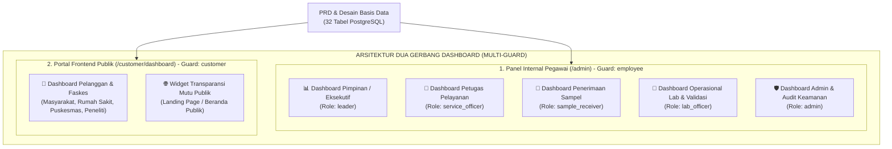
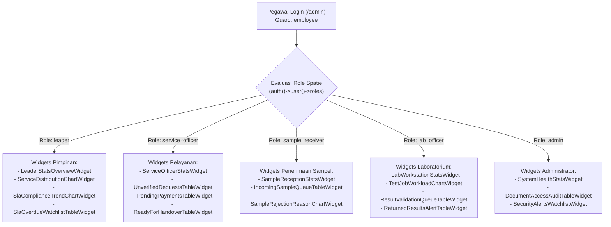
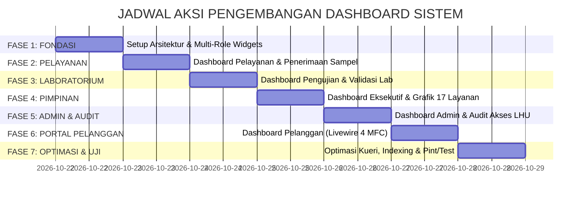

# RENCANA AKSI PENGEMBANGAN DASHBOARD SISTEM
## Sistem Informasi Laboratorium Balai Labkesmas Ambon

| Informasi Dokumen | Keterangan |
|---|---|
| **Topik Dokumen** | Rencana Aksi Perancangan & Implementasi Seluruh Dashboard Sistem (Internal Pegawai & Portal Pelanggan) |
| **Referensi Utama** | [PRD_dan_Desain_Basis_Data.md](file:///home/kurnia/HTDOCS/app-publik/PRD_dan_Desain_Basis_Data.md) |
| **Dokumen Pendukung** | [RENCANA_AKSI_FILAMENT_V5.md](file:///home/kurnia/HTDOCS/app-publik/RENCANA_AKSI_FILAMENT_V5.md) & [RENCANA_AKSI_DESAIN_FRONTEND_GOOGLE_STITCH.md](file:///home/kurnia/HTDOCS/app-publik/RENCANA_AKSI_DESAIN_FRONTEND_GOOGLE_STITCH.md) |
| **Framework & Stack** | Laravel 13.x, Filament v5.10.x, Livewire 4.x, Tailwind CSS v4.x, PHP 8.4, PostgreSQL 18 |
| **Sistem Keamanan** | Multi-Guard: `employee` (RBAC Spatie) & `customer` (Frontend Web Guard) |
| **Status Dokumen** | **Selesai Diimplementasikan (100% Complete & Verified - All Tests Pass)** |
| **Target Output** | 18 Widget Filament v5 (`app/Filament/Widgets/`), Portal Livewire 4 (`resources/views/pages/customer/⚡dashboard/`) |

---

## 1. Ringkasan Eksekutif & Prinsip Arsitektur

Dokumen ini merinci rencana aksi teknis untuk merancang dan membangun **seluruh varian dashboard** yang dibutuhkan dalam ekosistem Sistem Informasi Laboratorium Balai Laboratorium Kesehatan Masyarakat (Labkesmas) Ambon, merujuk langsung pada **Bab 2 (Siapa Saja Pengguna Sistem)** dan **Bab 4 (Laporan & Dashboard yang Dibutuhkan)** dari dokumen [PRD_dan_Desain_Basis_Data.md](file:///home/kurnia/HTDOCS/app-publik/PRD_dan_Desain_Basis_Data.md).

Pengembangan dashboard ini merupakan kelanjutan alami setelah fase tata kelola operasional layanan inti (Fase 1 s.d. Fase 6 pada [RENCANA_AKSI_FILAMENT_V5.md](file:///home/kurnia/HTDOCS/app-publik/RENCANA_AKSI_FILAMENT_V5.md)) diselesaikan.



### Prinsip Utama Perancangan Dashboard:
1. **Peran Spesifik & Akses Terbatas (Role-Tailored Context)**:
   Setiap dashboard hanya menyajikan indikator kinerja kunci (KPI), antrean tindakan, dan visualisasi data yang relevan dengan tanggung jawab tugas pegawai. Pegawai tidak dibebani informasi di luar wewenangnya.
2. **Kerahasiaan Medis & Perlindungan Privasi (Privacy-First Principle)**:
   Sesuai amanat PRD, Dashboard Pimpinan dan agregat publik **tidak menampilkan data pribadi sensitif atau nilai hasil klinis rahasia**. Detail hasil medis hanya dapat diakses oleh Analis, Validator, dan Pelanggan yang bersangkutan setelah otentikasi ganda.
3. **Berorientasi Tindakan (Action-Oriented Dashboard)**:
   Dashboard bukan sekadar tampilan grafik pasif, melainkan pusat komando kerja (*Workstation Hub*) yang dilengkapi dengan daftar antrean kritis (*actionable watchlists*) serta tombol tindakan langsung (misalnya: *Validasi Segera*, *Verifikasi Sampel*, *Terbitkan LHU*).
4. **Pemantauan SLA & Peringatan Dini (SLA Early Warning System)**:
   Menyediakan visualisasi status pengerjaan terhadap estimasi waktu penyelesaian (SLA) berdasarkan master `completion_estimates`, memberikan penanda warna mencolok (*Critical/Amber/Red*) bagi sampel yang mendekati atau melewati jatuh tempo.

---

## 2. Taksonomi & Matriks Pemetaan Seluruh Dashboard

Berdasarkan analisis menyeluruh terhadap seluruh aktor pengguna dan siklus hidup sampel uji di Balai Labkesmas Ambon, berikut adalah matriks pemetaan **6 dashboard utama + 1 widget transparansi publik**:

| Kode | Nama Dashboard | Pengguna Sasaran | Guard & Hak Akses | Platform & Lokasi | Frekuensi Refresh | Fokus Informasi Utama |
|---|---|---|---|---|---|---|
| **DSH-01** | **Dashboard Pimpinan (Executive Overview)** | Kepala Balai, Wakil Pimpinan, Koordinator Layanan | Guard: `employee`<br>Role: `leader` | Filament v5<br>`/admin` (Customized Dashboard) | Tiap 60 detik / On-Demand Filter | Agregat permohonan 17 layanan, kepatuhan SLA (%), waktu penyelesaian (TAT), LHU terbit vs diserahkan, rasio selesai/tertunda. |
| **DSH-02** | **Dashboard Petugas Pelayanan (Front Office)** | Petugas Loket, Administrasi Pelayanan | Guard: `employee`<br>Role: `service_officer` | Filament v5<br>`/admin` | Polling real-time (30s) | Antrean registrasi baru (Online/WA/Loket), berkas belum lengkap, tagihan belum lunas, LHU final siap diserahkan. |
| **DSH-03** | **Dashboard Penerimaan Sampel (Sample Station)** | Petugas Pengambil & Penerima Sampel Fisik | Guard: `employee`<br>Role: `sample_receiver` | Filament v5<br>`/admin` | Polling real-time (30s) | Antrean fisik sampel tiba, rasio terima vs tolak, rekap penyebab penolakan (volume/wadah), verifikasi cepat. |
| **DSH-04** | **Dashboard Operasional Laboratorium (Lab Workstation)** | Analis Kimia/Mikro, Kepala Instalasi, Validator Lab | Guard: `employee`<br>Role: `lab_officer` | Filament v5<br>`/admin` | Polling real-time (30s) | SPK aktif per instalasi, antrean validasi Manager Lab, validasi rekomendasi, retur perbaikan hasil, sampel kritis / overdue. |
| **DSH-05** | **Dashboard Administrator & Audit Sistem** | Pranata Komputer, Pengelola IT Balai | Guard: `employee`<br>Role: `admin` | Filament v5<br>`/admin` | Tiap 120 detik | Log akses dokumen LHU, kegagalan verifikasi nomor HP, volume aktivitas pengguna, status master tarif/katalog/SLA. |
| **DSH-06** | **Dashboard Pelanggan Mandiri & Faskes (Customer Portal)** | Pemohon Uji, Faskes (RS/Puskesmas), Perusahaan, Peneliti | Guard: `customer`<br>Session Auth | Livewire 4 MFC<br>`/customer/dashboard` | Event-driven / Reaktif | Progres permohonan mandiri, stepper status FPPS aktif, tagihan & invoice, LHU terbit siap unduh berstempel digital. |
| **DSH-07** | **Widget Transparansi Mutu Layanan (Public Kiosk)** | Masyarakat Umum, Pengunjung Portal | Publik (Guest)<br>Tanpa login | Livewire 4 SFC<br>Komponen Landing Page | Statis / Cache 1 jam | Statistik sampel teruji, rerata waktu penyelesaian resmi, kepuasan masyarakat, transparansi indeks mutu Labkesmas. |

---

## 3. Spesifikasi Detail Setiap Dashboard

---

### 3.1 DSH-01: Dashboard Pimpinan / Eksekutif (Executive Overview)

*Pusat kendali strategis bagi Kepala Balai Labkesmas Ambon untuk memonitor produktivitas laboratorium, mutu kecepatan layanan, dan kepatuhan standar pelayanan minimal tanpa memunculkan data medis privat.*

```
┌────────────────────────────────────────────────────────────────────────────────────────┐
│ 🏛️ DASHBOARD EKSEKUTIF PIMPINAN                                     [Filter: Bulan Ini ▼]│
├───────────────────┬───────────────────┬───────────────────┬────────────────────────────┤
│ Total Permohonan  │ Sampel Diproses   │ Kepatuhan SLA (%) │ LHU Terbit & Diserahkan    │
│ 1,248 Permohonan  │ 1,890 Sampel      │ 94.6% Tepat Waktu │ 1,180 Terbit (95% Serah)   │
│ ↑ 12% vs bln lalu │ ↑ 8% vs bln lalu  │ Target: ≥ 90%     │ 1,120 Diambil Pemohon      │
├───────────────────┴───────────────────┴───────────────────┴────────────────────────────┤
│ 📊 GRAFIK DISTRIBUSI 17 KELOMPOK LAYANAN (BROSUR)   │ ⏱️ TREN WAKTU PENYELESAIAN (TAT)   │
│ [Air Bersih: 340] [Air Minum: 280] [Makanan: 210]  │ Target SLA: 10 Hari Kalender       │
│ [Patologi: 180] [Limbah Faskes: 150] [Lainnya: ...] │ Rerata Aktual: 6.8 Hari            │
├────────────────────────────────────────────────────┴────────────────────────────────────┤
│ ⚠️ DAFTAR PENGAWASAN KETERLAMBATAN (SLA OVERDUE / PERLU PERHATIAN KHUSUS)               │
│ • No. FPPS: FPPS-2026-00412 | Layanan: Air Sungai | Instalasi: Kimia | Telat: +2 Hari    │
│ • No. FPPS: FPPS-2026-00398 | Layanan: Mikrobiologi| Instalasi: Mikro | Telat: +1 Hari   │
└────────────────────────────────────────────────────────────────────────────────────────┘
```

#### A. Komponen Kartu Metrik (StatsOverviewWidget):
1. **Total Permohonan & Sampel**:
   - Sumber: `TestRequest::whereBetween('registered_at', [$start, $end])->count()` dan `Sample::count()`.
   - Menampilkan persentase kenaikan/penurunan dibanding periode sebelumnya.
2. **Kepatuhan SLA (SLA Compliance Rate)**:
   - Rumus: `(Jumlah Permohonan Selesai <= Estimated Completion Date / Total Selesai) * 100%`.
   - Warna: Hijau jika $\ge 90\%$, Kuning jika $80\% - 89\%$, Merah jika $< 80\%$.
3. **Turnaround Time (Rerata Durasi Pengujian)**:
   - Menghitung selisih rata-rata (dalam hari kalender) dari `registered_at` / `paid_at` sampai `test_reports.issued_at`.
4. **Rasio Terbit LHU vs Penyerahan**:
   - Jumlah LHU berstatus `final` dibandingkan jumlah yang telah memiliki relasi di `report_handovers`.

#### B. Visualisasi Grafik (ChartWidgets):
1. **DistributionByServiceGroupChart (Bar / Donut Chart)**:
   - Menampilkan volume pengujian di 17 kelompok layanan resmi (Air Bersih, Air Minum, Air Laut, Air Limbah Domestik, Air Limbah Faskes, Makanan, Swab Alat, Air Sungai, Air Kolam Renang, Udara Ambien, Udara Ruangan, Bakteriologi Udara, Patologi Klinis, Vektor, Penelitian, Mikrobiologi/Parasitologi/Biomolekuler, dan Kalibrasi).
2. **MonthlyThroughputTrendChart (Line Chart)**:
   - Tren pergerakan permohonan masuk vs permohonan selesai selama 12 bulan terakhir.

#### C. Tabel Pengawasan (TableWidget):
- **OverdueSlaWatchlist**: Daftar permohonan yang tanggal hari ini telah melewati `estimated_completion_date` dan statusnya belum `selesai` / `lhu_terbit`.
- Kolom: Nomor FPPS, Kelompok Layanan, Unit Laboratorium yang Menangani, Tanggal Registrasi, Target SLA, Keterlambatan (Hari).

---

### 3.2 DSH-02: Dashboard Petugas Pelayanan (Front Office & Loket)

*Pusat operasional gerbang pelayanan untuk mengelola permohonan masuk, memeriksa kelengkapan berkas pemohon, mencatat pembayaran, dan mengoordinasikan penyerahan hasil uji.*

```
┌────────────────────────────────────────────────────────────────────────────────────────┐
│ 📝 DASHBOARD PETUGAS PELAYANAN (LOKET & KONSULTASI)                [Status: Real-Time 🟢]│
├───────────────────┬───────────────────┬───────────────────┬────────────────────────────┤
│ Permohonan Baru   │ Menunggu Berkas   │ Menunggu Bayar    │ LHU Siap Diserahkan        │
│ 18 Hari Ini       │ 6 Permohonan      │ 12 Permohonan     │ 24 Dokumen Siap            │
│ (Online: 11, WA: 7)│ Butuh Konfirmasi  │ Menunggu Kwitansi │ Menunggu Diambil/Kirim     │
├───────────────────┴───────────────────┴───────────────────┴────────────────────────────┤
│ ⚡ AKSI CEPAT: [➕ Registrasi Loket/WA]  [💳 Catat Pembayaran]  [📦 Serah Terima LHU]     │
├────────────────────────────────────────────────────────────────────────────────────────┤
│ 📋 ANTREAN PENDAFTARAN ONLINE & WHATSAPP (MENUNGGU VERIFIKASI PETUGAS)                 │
│ • REQ-20261021-001 | RSUD Haulussy | Air Minum | Online | [Verifikasi & Generate FPPS] │
│ • REQ-20261021-004 | Dinas Kesehatan | Makanan | WA     | [Lengkapi Data Pemohon]      │
├────────────────────────────────────────────────────────────────────────────────────────┤
│ 📑 ANTREAN LHU FINAL YANG SIAP DISERAHKAN KE PELANGGAN                                 │
│ • FPPS-2026-00388 | Puskesmas Rijali | LHU/2026/X/0142 | Status: Belum Diambil [Serahkan]│
└────────────────────────────────────────────────────────────────────────────────────────┘
```

#### A. Komponen Kartu Metrik:
1. **Permohonan Baru Hari Ini**: Total permohonan terdaftar hari ini berdasarkan kanal (`online`, `whatsapp`, `counter`).
2. **Menunggu Kelengkapan Berkas**: Permohonan dengan status `menunggu_kelengkapan` (dokumen pendukung belum diunggah atau tidak valid).
3. **Menunggu Pembayaran**: Permohonan yang telah diverifikasi biayanya namun `payment_status` masih `unpaid` / `pending`.
4. **LHU Siap Diserahkan**: Jumlah dokumen LHU berstatus `final` yang belum tercatat pada tabel `report_handovers`.

#### B. Antrean Aksi Cepat (Actionable Watchlists):
1. **UnverifiedRequestsTable**:
   - Menampilkan permohonan baru dari web publik atau WhatsApp yang perlu diperiksa persyaratannya.
   - Tindakan: Tombol konfirmasi, periksa rincian parameter, cetak tanda terima pendaftaran.
2. **PendingPaymentsTable**:
   - Menampilkan tagihan permohonan yang menunggu verifikasi bukti setor/pembayaran di loket kasir.
   - Tindakan: Modal cepat *Catat Pembayaran* (`PaymentResource::create`).
3. **ReadyForHandoverTable**:
   - Menampilkan LHU yang sudah disahkan dan siap dicetak/diserahkan.
   - Tindakan: Modal *Catat Serah Terima* (`ReportHandover`), cetak surat tanda terima penyerahan.

---

### 3.3 DSH-03: Dashboard Penerimaan Sampel (Sample Reception Station)

*Stasiun kerja khusus untuk petugas penerima sampel fisik di loket penerimaan untuk memeriksa kelayakan wadah, volume sampel, serta mencatat keputusan Terima/Tolak.*

```
┌────────────────────────────────────────────────────────────────────────────────────────┐
│ 🧪 DASHBOARD STASIUN PENERIMAAN SAMPEL FISIK                      [Status: Real-Time 🟢]│
├───────────────────┬───────────────────┬───────────────────┬────────────────────────────┤
│ Antrean Sampel Tiba│ Sampel Diterima   │ Sampel Ditolak    │ Rasio Penolakan            │
│ 14 Sampel         │ 42 Sampel Hari Ini│ 3 Sampel Hari Ini │ 6.7% Hari Ini              │
│ Menunggu Cek Fisik│ Lanjut Pengujian  │ Berita Acara Siap │ Alasan: Wadah Rusak/Kurang │
├───────────────────┴───────────────────┴───────────────────┴────────────────────────────┤
│ 🔍 ANTREAN SAMPEL FISIK MENUNGGU VERIFIKASI KELAYAKAN                                  │
│ • No. FPPS: FPPS-2026-00450 | Kode: SMP-0891 | Jenis: Air Bersih | Min: 2000 mL        │
│   Aksi: [✅ TERIMA SAMPEL]  atau  [❌ TOLAK (Input Alasan Wajib)]                       │
│ • No. FPPS: FPPS-2026-00451 | Kode: SMP-0892 | Jenis: Usap Alat Makanan                 │
│   Aksi: [✅ TERIMA SAMPEL]  atau  [❌ TOLAK (Input Alasan Wajib)]                       │
├────────────────────────────────────────────────────────────────────────────────────────┤
│ 📊 TOP ALASAN PENOLAKAN SAMPEL BULAN INI                                               │
│ 1. Volume kurang dari batas minimum (52%) | 2. Wadah tidak steril/bocor (31%)          │
└────────────────────────────────────────────────────────────────────────────────────────┘
```

#### A. Komponen Kartu Metrik:
1. **Antrean Sampel Tiba**: Jumlah baris pada tabel `samples` dengan status `menunggu_penerimaan`.
2. **Sampel Diterima Hari Ini**: Total sampel yang diputuskan `decision = 'accepted'` pada hari berjalan.
3. **Sampel Ditolak Hari Ini**: Total sampel yang diputuskan `decision = 'rejected'`.
4. **Tingkat Penolakan (Rejection Rate %)**: `(Sampel Ditolak / Total Sampel Diperiksa) * 100%`.

#### B. Fitur & Antrean Interaktif:
1. **SampleCheckQueueTable**:
   - Menampilkan sampel yang diserahkan pelanggan.
   - Dilengkapi informasi master dari `sample_types`: volume minimum (`min_volume`), syarat wadah (`container_requirement`), dan persyaratan khusus (`requirements`).
   - Aksi Instan:
     - Modal **Terima Sampel**: Mencatat volume aktual yang diterima, kondisi fisik, dan otomatis meneruskan status ke antrean kerja laboratorium.
     - Modal **Tolak Sampel**: Wajib mengisi alasan penolakan (`rejection_reason`) dan rekomendasi tindak lanjut (`follow_up`).

---

### 3.4 DSH-04: Dashboard Operasional Laboratorium (Lab Workstation)

*Pusat kendali teknis bagi Analis Laboratorium, Kepala Instalasi, dan Validator Hasil untuk mengelola antrean pengujian, pelaksanaan analisis, pengesahan hasil bertahap, dan penanganan hasil retur.*

```
┌────────────────────────────────────────────────────────────────────────────────────────┐
│ 🔬 DASHBOARD OPERASIONAL LABORATORIUM & VALIDASI HASIL            [Unit: Semua Unit ▼] │
├───────────────────┬───────────────────┬───────────────────┬────────────────────────────┤
│ Antrean Uji Aktif │ Menunggu Validasi │ Validasi Rekomend.│ Perlu Revisi / Retur       │
│ 38 Surat Tugas    │ 14 Menunggu Kabag │ 5 Tahap Akhir     │ 3 Perlu Koreksi Analis     │
│ (Kimia: 22, Mik: 16│ Manager Lab       │ Rekomendasi Medis │ ⚠️ Prioritas Tinggi        │
├───────────────────┴───────────────────┴───────────────────┴────────────────────────────┤
│ 🚨 PERINGATAN SLA: 4 PEKERJAAN MENDEKATI / MELEWATI ESTIMASI WAKTU                     │
│ • JOB-2026-0210 | Air Kolam Renang | Sisa Waktu: 4 Jam | Analis: Budi, A.Md.AK [Input] │
│ • JOB-2026-0205 | Makanan (Formalin)| OVERDUE (+1 Hari) | Validator: Dr. Hendra [Cek]  │
├────────────────────────────────────────────────────────────────────────────────────────┤
│ 📑 ANTREAN VALIDASI MANAGER LAB (TAHAP 1)                                              │
│ • Hasil SMP-0881 | Parameter: BOD, COD, DO | Analis: Sarah, S.Si | [Review & Sahkan]    │
│ • Hasil SMP-0885 | Parameter: Coliform | Analis: Fahmi, A.Md.AK  | [Review & Sahkan]    │
└────────────────────────────────────────────────────────────────────────────────────────┘
```

#### A. Komponen Kartu Metrik:
1. **Pekerjaan Uji Aktif**: Total Surat Perintah Kerja (`test_jobs`) yang sedang berjalan (`status = 'in_progress'`).
2. **Menunggu Validasi Manager Lab**: Hasil uji (`test_results`) yang telah disubmit analis (`status = 'submitted'`) dan menunggu approval Kepala Instalasi / Manager Teknis.
3. **Menunggu Validasi Rekomendasi**: Hasil uji yang memerlukan telaah interpretasi dan rekomendasi kesehatan masyarakat sebelum diterbitkan.
4. **Hasil Diretur (Needs Revision)**: Hasil yang dikembalikan (`status = 'returned'`) oleh validator karena ketidaksesuaian metode, blanko sampel tidak valid, atau kesalahan penulisan angka.
5. **Pekerjaan Overdue (SLA Breached)**: Pekerjaan laboratorium yang melebihi batas waktu estimasi.

#### B. Antrean Aksi & Validasi:
1. **ValidationQueueTable (Untuk Validator & Kepala Instalasi)**:
   - Menampilkan daftar hasil uji yang telah diselesaikan analis.
   - Komparasi otomatis nilai hasil terhadap baku mutu (`threshold_min` s.d. `threshold_max` atau `threshold_text`).
   - Aksi:
     - **Setujui (Approve)**: Mengubah status hasil menjadi tervalidasi dan mengunci baris data (`is_locked = true`).
     - **Kembalikan (Return)**: Membuka modal catatan revisi yang wajib diisi dan mencatat histori di `result_validations`.
2. **RevisionTasksTable (Untuk Analis)**:
   - Menampilkan hasil uji yang dikembalikan oleh validator agar segera diperbaiki.
   - Membuka form koreksi berjejak audit ke tabel `result_revisions`.

---

### 3.5 DSH-05: Dashboard Administrator & Audit Keamanan

*Pusat monitoring infrastruktur data bagi Pranata Komputer untuk menjaga keandalan sistem, memantau riwayat akses dokumen LHU resmi, mendeteksi insiden keamanan, dan mengelola master katalog layanan.*

```
┌────────────────────────────────────────────────────────────────────────────────────────┐
│ 🛡️ DASHBOARD ADMINISTRATOR & AUDIT KEAMANAN SISTEM                 [Status: Optimal 🟢]│
├───────────────────┬───────────────────┬───────────────────┬────────────────────────────┤
│ Pegawai Online    │ Akses Dokumen LHU │ Log Aktivitas     │ Integritas Master Data     │
│ 12 Pegawai Aktif  │ 86 Kali Hari Ini  │ 412 Aksi Tercatat │ 17 Kelompok Aktif          │
│ Guard: employee   │ (Unduh: 54, Cetak: 32│ 24 Jam Terakhir   │ 142 Parameter Siap         │
├───────────────────┴───────────────────┴───────────────────┴────────────────────────────┤
│ 📜 LOG TERBARU AKSES & UNDUH DOKUMEN LHU (DOCUMENT ACCESS AUDIT TRAIL)                 │
│ • 09:12:40 | LHU/2026/X/0140 | Unduh PDF | Customer: RSUD Haulussy | IP: 180.245.xx.xx │
│ • 08:55:12 | LHU/2026/X/0138 | Cetak Fisik | Petugas: Meilani (Loket) | IP: 192.168.1.42│
│ • 08:30:05 | LHU/2026/X/0135 | Gagal Unduh | Nomor HP Tidak Cocok   | IP: 114.122.xx.xx│
├────────────────────────────────────────────────────────────────────────────────────────┤
│ ⚙️ PENGATURAN CEPAT SISTEM                                                             │
│ [Master Tarif 2026]  [Konfigurasi Hari Libur/SLA]  [Template Kop & Pengesahan LHU]     │
└────────────────────────────────────────────────────────────────────────────────────────┘
```

#### A. Komponen Kartu Metrik:
1. **Sesi Pegawai Aktif**: Jumlah pegawai dengan `last_login_at` dalam rentang waktu aktif.
2. **Volume Akses LHU**: Total tindakan `view`, `download`, dan `print` pada tabel `document_access_logs`.
3. **Log Aktivitas Transaksional**: Total event mutasi data pada `activity_logs`.
4. **Status Master Data**: Indikator apakah ada kelompok layanan yang belum memiliki tarif aktif atau estimasi SLA.

#### B. Widget Keamanan & Audit:
1. **LhuAccessAuditFeed**:
   - Menampilkan feed aktivitas akses dokumen LHU secara langsung (Siapa yang mengakses, dokumen apa, jam berapa, alamat IP, dan jenis tindakan).
   - Memberikan tanda peringatan jika ada upaya pencocokan nomor HP pelanggan yang gagal berulang kali (*brute-force detection*).
2. **SystemActivityStream**:
   - Rekam jejak perubahan data master (tarif diubah, parameter diedit, role/permission diperbarui).

---

### 3.6 DSH-06: Dashboard Pelanggan Mandiri & Faskes (Customer & Partner Portal)

*Portal mandiri ramah pengguna di web frontend (`/customer/dashboard`) berbasis Livewire 4, dirancang khusus untuk pemohon uji mandiri, rumah sakit, puskesmas, klinik, perusahaan industri, dan peneliti.*

```
┌────────────────────────────────────────────────────────────────────────────────────────┐
│ 🏥 PORTAL PELANGGAN - BALAI LABKESMAS AMBON              Halo, RSUD Dr. M. Haulussy 👋 │
├───────────────────┬───────────────────┬───────────────────┬────────────────────────────┤
│ Permohonan Aktif  │ Sampel Diuji      │ Tagihan Belum Byr │ LHU Siap Diunduh           │
│ 3 Permohonan      │ 5 Sampel Berjalan │ 1 Permohonan      │ 2 Dokumen Final            │
│ Status: Diproses  │ Selesai: 2 Sampel │ Rp 484.000 (VA)   │ PDF Resmi Berstempel       │
├───────────────────┴───────────────────┴───────────────────┴────────────────────────────┤
│ 🚀 AKSI CEPAT: [➕ Ajukan Permohonan Uji Baru]  [🔍 Lacak No. FPPS Lain]  [📞 Kontak CS]│
├────────────────────────────────────────────────────────────────────────────────────────┤
│ 📍 PROGRES PERMOHONAN TERAKHIR (FPPS-2026-00412 - Paket Air Limbah Faskes)             │
│   [✓ Pendaftaran] ──> [✓ Sampel Diterima] ──> [✓ Sedang Diuji] ──> [⚪ Validasi] ──> [⚪ LHU]│
│   Estimasi Selesai: 24 Oktober 2026 | Posisi: Tahap Validasi Teknis Lab                │
├────────────────────────────────────────────────────────────────────────────────────────┤
│ 📑 ARSIP DOKUMEN LAPORAN HASIL UJI (LHU) RESMI SAYA                                    │
│ • No. LHU: LHU/2026/X/0138 | Layanan: Air Bersih | Tanggal: 18 Okt 2026 | [⬇️ Unduh PDF]│
│ • No. LHU: LHU/2026/IX/0890| Layanan: Swab Alat  | Tanggal: 25 Sep 2026 | [⬇️ Unduh PDF]│
└────────────────────────────────────────────────────────────────────────────────────────┘
```

#### A. Komponen Kartu Ringkasan (Customer Metric Cards):
1. **Permohonan Aktif**: Permohonan yang sedang dalam tahapan proses (belum selesai penyerahan).
2. **Sampel Dalam Pengujian**: Jumlah sampel fisik milik pelanggan yang sedang berada di meja analisis lab.
3. **Tagihan Belum Dibayar**: Total tagihan permohonan yang berstatus belum lunas beserta instruksi nomor rekening/VA resmi.
4. **LHU Siap Diunduh**: Dokumen LHU final yang telah diterbitkan Balai dan siap diunduh dalam format PDF resmi.

#### B. Komponen Interaktif Pelanggan:
1. **ActiveRequestTrackerWidget**:
   - Stepper visual 5 tahapan yang menunjukkan progres permohonan paling mutakhir milik pelanggan:
     *(1) Pendaftaran Berhasil -> (2) Sampel Diterima di Balai -> (3) Pengujian Laboratorium -> (4) Validasi Hasil -> (5) LHU Final Terbit*.
   - Menampilkan tanggal estimasi selesai dan waktu sisa pengerjaan secara transparan.
2. **CustomerRequestsTable**:
   - Tabel riwayat permohonan dengan fitur pencarian dan filter status.
   - Kolom: Nomor FPPS, Tanggal Pengajuan, Kelompok Layanan, Jumlah Sampel, Status Pembayaran, Status Proses, dan Tombol Rincian.
3. **OfficialReportsArchiveTable**:
   - Arsip seluruh dokumen LHU yang pernah diterbitkan untuk akun pelanggan/faskes tersebut.
   - Tombol **Unduh PDF Resmi**: Otomatis memicu pencatatan log ke `document_access_logs` (tindakan `download`, IP pelanggan, dan waktu akses).

---

### 3.7 DSH-07: Widget Transparansi Mutu Layanan (Public Kiosk)

*Komponen publik tanpa login yang ditempatkan pada Beranda/Landing Page portal web Balai Labkesmas Ambon untuk menampilkan transparansi kecepatan dan mutu layanan publik.*

- **Metrik yang Ditampilkan**:
  - Total Pengujian Diselesaikan Tahun Ini (misal: 14.820 Sampel).
  - Indeks Kepatuhan SLA Layanan (misal: 96,2% Selesai Sesuai Estimasi).
  - Rata-rata Durasi Pengujian Aktual (misal: 6,4 Hari Kalender).
  - 17 Kelompok Layanan Terakreditasi KAN / ISO 17025.
- **Karakteristik Teknis**:
  - Data diagregasi secara asinkron dan disimpan dalam cache aplikasi (`Cache::remember('public_service_metrics', 3600, ...)`).
  - Nol risiko kebocoran data rahasia karena hanya menyajikan data numerik makro.

---

## 4. Desain Arsitektur Teknis & Struktur Komponen

### 4.1 Arsitektur Panel Internal Filament v5 (`/admin`)

Untuk panel internal pegawai, kita menerapkan arsitektur **Role-Based Dynamic Widget Resolution** pada halaman dashboard utama (`Filament\Pages\Dashboard`). Setiap widget mengimplementasikan method `canView()` yang mengevaluasi role atau permission pegawai yang sedang login.



#### Struktur Kelas Widget Filament (`app/Filament/Widgets/`):
```
app/Filament/Widgets/
├── Leader/
│   ├── LeaderStatsOverviewWidget.php
│   ├── ServiceDistributionChartWidget.php
│   ├── SlaComplianceTrendChartWidget.php
│   └── SlaOverdueWatchlistTableWidget.php
├── Service/
│   ├── ServiceOfficerStatsWidget.php
│   ├── UnverifiedRequestsTableWidget.php
│   ├── PendingPaymentsTableWidget.php
│   └── ReadyForHandoverTableWidget.php
├── Sample/
│   ├── SampleReceptionStatsWidget.php
│   ├── IncomingSampleQueueTableWidget.php
│   └── SampleRejectionReasonChartWidget.php
├── Lab/
│   ├── LabWorkstationStatsWidget.php
│   ├── TestJobWorkloadChartWidget.php
│   ├── ResultValidationQueueTableWidget.php
│   └── ReturnedResultsAlertTableWidget.php
└── Admin/
    ├── SystemHealthStatsWidget.php
    ├── DocumentAccessAuditTableWidget.php
    └── SecurityAlertsWatchlistWidget.php
```

#### Contoh Pola Hak Akses pada Widget Filament (`canView`):
```php
namespace App\Filament\Widgets\Leader;

use Filament\Widgets\StatsOverviewWidget;
use Illuminate\Support\Facades\Auth;

class LeaderStatsOverviewWidget extends StatsOverviewWidget
{
    protected ?string $pollingInterval = '60s';

    public static function canView(): bool
    {
        $employee = Auth::guard('employee')->user();
        return $employee && ($employee->hasRole('leader') || $employee->hasRole('admin'));
    }

    protected function getStats(): array
    {
        // Agregasi data KPI eksekutif pimpinan
        return [ ... ];
    }
}
```

### 4.2 Arsitektur Portal Pelanggan Livewire 4 (`/customer/dashboard`)

Untuk portal pelanggan di frontend publik, kita menggunakan arsitektur **Livewire 4 Multi-File Component (MFC)** yang terisolasi dengan Guard `customer`.

```
resources/views/pages/customer/⚡dashboard/
├── dashboard.php         # Logic controller: data loader, pagination, event listeners
└── dashboard.blade.php   # Antarmuka Tailwind v4: stepper, cards, tabel riwayat, modal unduh
```

#### Contoh Logika Controller Livewire 4 (`dashboard.php`):
```php
<?php

use App\Models\TestReport;
use App\Models\TestRequest;
use Illuminate\Support\Facades\Auth;
use Livewire\Attributes\Layout;
use Livewire\Attributes\Title;
use Livewire\Component;
use Livewire\WithPagination;

new #[Layout('layouts::app')] #[Title('Portal Pelanggan - Balai Labkesmas Ambon')] class extends Component {
    use WithPagination;

    public string $searchFpps = '';
    public string $filterStatus = 'all';

    public function getCustomerProperty()
    {
        return Auth::guard('customer')->user();
    }

    public function getSummaryStatsProperty(): array
    {
        $customerId = $this->customer->id;

        return [
            'total_requests' => TestRequest::where('customer_id', $customerId)->count(),
            'active_tests' => TestRequest::where('customer_id', $customerId)
                ->whereNotIn('status', ['lhu_terbit', 'selesai', 'dibatalkan'])
                ->count(),
            'pending_payments' => TestRequest::where('customer_id', $customerId)
                ->where('payment_status', 'unpaid')
                ->count(),
            'ready_reports' => TestReport::whereHas('testRequest', fn ($q) => $q->where('customer_id', $customerId))
                ->where('status', 'final')
                ->count(),
        ];
    }

    public function getActiveRequestsProperty()
    {
        return TestRequest::where('customer_id', $this->customer->id)
            ->with(['serviceGroup', 'samples.sampleType', 'testReports'])
            ->when($this->searchFpps, fn ($q) => $q->where('fpps_number', 'ilike', "%{$this->searchFpps}%"))
            ->latest('registered_at')
            ->paginate(5);
    }
};
```

---

## 5. Pemetaan Relasi Basis Data & Formula Kueri Agregasi

Untuk menjaga performa query dashboard tetap cepat dan tidak membebani server database PostgreSQL, berikut adalah pemetaan kueri SQL/Eloquent dan kebutuhan indeks pada 32 tabel basis data:

| Dashboard | Komponen Metrik | Tabel Terlibat | Query Agregasi Eloquent Utama | Kebutuhan Indeks Database |
|---|---|---|---|---|
| **DSH-01** (Pimpinan) | Total Permohonan & Sampel | `test_requests`, `samples` | `TestRequest::whereBetween('registered_at', [$from, $to])->count()` | `registered_at`, `status` |
| **DSH-01** (Pimpinan) | Distribusi 17 Layanan | `service_groups`, `test_requests` | `ServiceGroup::withCount(['testRequests' => fn($q) => $q->whereBetween(...)])->get()` | `service_group_id` |
| **DSH-01** (Pimpinan) | Kepatuhan SLA (%) | `test_requests`, `completion_estimates` | `TestRequest::where('status', 'selesai')->selectRaw("AVG(CASE WHEN updated_at::date <= estimated_completion_date THEN 100 ELSE 0 END)")->value('avg')` | `estimated_completion_date` |
| **DSH-02** (Pelayanan) | Antrean Registrasi Baru | `test_requests` | `TestRequest::whereIn('status', ['menunggu_konfirmasi', 'menunggu_kelengkapan'])->latest()` | `status`, `channel` |
| **DSH-02** (Pelayanan) | Tagihan Menunggu Bayar | `test_requests`, `payments` | `TestRequest::where('payment_status', 'unpaid')->sum('total_amount')` | `payment_status` |
| **DSH-02** (Pelayanan) | LHU Siap Serah | `test_reports`, `report_handovers` | `TestReport::where('status', 'final')->whereDoesntHave('reportHandovers')->count()` | `status` di `test_reports` |
| **DSH-03** (Penerimaan) | Antrean Cek Sampel | `samples` | `Sample::where('status', 'menunggu_penerimaan')->with('sampleType')->get()` | `status` di `samples` |
| **DSH-03** (Penerimaan) | Analisis Penolakan | `sample_receipts` | `SampleReceipt::where('decision', 'rejected')->selectRaw('rejection_reason, count(*)')->groupBy('rejection_reason')` | `decision`, `received_at` |
| **DSH-04** (Laboratorium) | Antrean Validasi Manager | `test_results` | `TestResult::where('status', 'submitted')->where('is_locked', false)->with(['testJob.sample', 'analyst'])` | `status`, `is_locked` |
| **DSH-04** (Laboratorium) | Hasil Perlu Revisi | `test_results`, `result_revisions` | `TestResult::where('status', 'returned')->with('latestRevision')` | `status` di `test_results` |
| **DSH-04** (Laboratorium) | Beban Kerja Instalasi | `test_jobs`, `laboratory_units` | `LaboratoryUnit::withCount(['testJobs' => fn($q) => $q->where('status', 'in_progress')])->get()` | `laboratory_unit_id` |
| **DSH-05** (Admin) | Audit Akses Dokumen | `document_access_logs` | `DocumentAccessLog::with(['testReport', 'customer', 'employee'])->latest('accessed_at')->limit(15)` | `accessed_at`, `action` |
| **DSH-06** (Pelanggan) | Progres FPPS Saya | `test_requests`, `status_histories` | `TestRequest::where('customer_id', $authId)->with('statusHistories')->get()` | `customer_id`, `fpps_number` |

---

## 6. Tahapan Pelaksanaan & Roadmap Aksi

Pengembangan dashboard akan dieksekusi secara terstruktur dalam **7 fase bertahap**:



### Fase 1: Fondasi Widget & Arsitektur Multi-Role Filament (Hari 1)
- [x] Memodifikasi [AdminPanelProvider.php](file:///home/kurnia/HTDOCS/app-publik/app/Providers/Filament/AdminPanelProvider.php) untuk mendaftarkan direktori widget `app/Filament/Widgets`.
- [x] Membuat base dashboard handler dan konfigurasi layout grid responsif (1 kolom di mobile, 2 kolom di tablet, 3-4 kolom di desktop).
- [x] Menyiapkan trait reusable `HasDateRangeFilter` untuk mempermudah pemfilteran periode tanggal global di dashboard.

### Fase 2: Dashboard Pelayanan & Penerimaan Sampel Fisik (Hari 2)
- [x] Membuat widget kartu statistik pelayanan: `ServiceOfficerStatsWidget`.
- [x] Membuat widget antrean permohonan baru & verifikasi: `UnverifiedRequestsTableWidget`.
- [x] Membuat widget tagihan belum bayar: `PendingPaymentsTableWidget`.
- [x] Membuat widget LHU siap serah: `ReadyForHandoverTableWidget`.
- [x] Membuat widget stasiun penerimaan sampel: `SampleReceptionStatsWidget` dan `IncomingSampleQueueTableWidget`.
- [x] Menguji aksi modal cepat konfirmasi berkas, catat pembayaran, dan penerimaan sampel fisik.

### Fase 3: Dashboard Teknis Laboratorium & Validasi Bertahap (Hari 3)
- [x] Membuat widget kartu beban kerja lab: `LabWorkstationStatsWidget`.
- [x] Membuat grafik beban kerja per instalasi: `TestJobWorkloadChartWidget`.
- [x] Membuat tabel antrean validasi Manager Lab: `ResultValidationQueueTableWidget`.
- [x] Membuat tabel alert hasil retur/koreksi: `ReturnedResultsAlertTableWidget`.
- [x] Mengintegrasikan alert visual penanda batas waktu kritis (SLA Overdue warning).

### Fase 4: Dashboard Eksekutif Pimpinan & Analitik 17 Layanan (Hari 4)
- [x] Membuat widget KPI pimpinan: `LeaderStatsOverviewWidget` (Permohonan, Sampel, Kepatuhan SLA %, Rerata TAT).
- [x] Membuat chart visual 17 kelompok layanan: `ServiceDistributionChartWidget` (Air Bersih, Air Minum, Makanan, Limbah, Patologi, dll.).
- [x] Membuat chart tren waktu penyelesaian bulanan: `SlaComplianceTrendChartWidget`.
- [x] Membuat watchlist keterlambatan layanan: `SlaOverdueWatchlistTableWidget`.
- [x] Memastikan filter rentang waktu (Harian, Mingguan, Bulanan, Tahunan) berjalan dinamis.

### Fase 5: Dashboard Administrator & Audit Akses Dokumen (Hari 5)
- [x] Membuat widget kesehatan sistem: `SystemHealthStatsWidget`.
- [x] Membuat tabel audit trail akses LHU: `DocumentAccessAuditTableWidget` (View, Download, Print).
- [x] Membuat widget monitoring keamanan: `SecurityAlertsWatchlistWidget` (Deteksi kegagalan verifikasi nomor HP).

### Fase 6: Dashboard Portal Pelanggan & Faskes di Livewire 4 (Hari 6)
- [x] Membangun antarmuka [dashboard.blade.php](file:///home/kurnia/HTDOCS/app-publik/resources/views/pages/customer/%E2%9A%A1dashboard/dashboard.blade.php) menggunakan Tailwind CSS v4 sesuai token [DESIGN.md](file:///home/kurnia/HTDOCS/app-publik/DESIGN.md).
- [x] Membangun controller reaktif [dashboard.php](file:///home/kurnia/HTDOCS/app-publik/resources/views/pages/customer/%E2%9A%A1dashboard/dashboard.php) dengan Livewire 4 Multi-File Component.
- [x] Mengimplementasikan stepper progres FPPS real-time 5 tahap.
- [x] Menyediakan tabel riwayat pengujian dan tombol unduh LHU final berstempel resmi.
- [x] Menghubungkan trigger unduh dengan pencatatan otomatis ke `document_access_logs`.

### Fase 7: Optimasi Kueri, Indexing, Caching, & Pengujian Komprehensif (Hari 7)
- [x] Memeriksa dan menambahkan indeks database pada kolom-kolom query agregat (`registered_at`, `status`, `payment_status`, `estimated_completion_date`, `customer_id`).
- [x] Menambahkan query caching untuk data statistik berat yang jarang berubah.
- [x] Menulis Feature Tests (PHPUnit) untuk memastikan isolasi hak akses widget per role:
  - Pimpinan dapat melihat `LeaderStatsOverviewWidget` namun tidak dapat melihat antrean input analis.
  - Petugas Pelayanan tidak dapat melihat audit security internal admin.
  - Pelanggan hanya dapat melihat data milik akunnya sendiri.
- [x] Menjalankan standarisasi kode dengan Laravel Pint (`vendor/bin/pint --format agent`).

---

## 7. Katalog Perintah Artisan yang Akan Digunakan

### 7.1 Pembuatan Widget Filament v5 (Panel Internal)
```bash
# Widget Pimpinan / Eksekutif
php artisan make:filament-widget Leader/LeaderStatsOverviewWidget --stats-overview --no-interaction
php artisan make:filament-widget Leader/ServiceDistributionChartWidget --chart --no-interaction
php artisan make:filament-widget Leader/SlaComplianceTrendChartWidget --chart --no-interaction
php artisan make:filament-widget Leader/SlaOverdueWatchlistTableWidget --table --no-interaction

# Widget Petugas Pelayanan
php artisan make:filament-widget Service/ServiceOfficerStatsWidget --stats-overview --no-interaction
php artisan make:filament-widget Service/UnverifiedRequestsTableWidget --table --no-interaction
php artisan make:filament-widget Service/PendingPaymentsTableWidget --table --no-interaction
php artisan make:filament-widget Service/ReadyForHandoverTableWidget --table --no-interaction

# Widget Penerimaan Sampel
php artisan make:filament-widget Sample/SampleReceptionStatsWidget --stats-overview --no-interaction
php artisan make:filament-widget Sample/IncomingSampleQueueTableWidget --table --no-interaction
php artisan make:filament-widget Sample/SampleRejectionReasonChartWidget --chart --no-interaction

# Widget Operasional Laboratorium & Validasi
php artisan make:filament-widget Lab/LabWorkstationStatsWidget --stats-overview --no-interaction
php artisan make:filament-widget Lab/TestJobWorkloadChartWidget --chart --no-interaction
php artisan make:filament-widget Lab/ResultValidationQueueTableWidget --table --no-interaction
php artisan make:filament-widget Lab/ReturnedResultsAlertTableWidget --table --no-interaction

# Widget Administrator & Audit
php artisan make:filament-widget Admin/SystemHealthStatsWidget --stats-overview --no-interaction
php artisan make:filament-widget Admin/DocumentAccessAuditTableWidget --table --no-interaction
php artisan make:filament-widget Admin/SecurityAlertsWatchlistWidget --table --no-interaction
```

### 7.2 Pengujian & Standarisasi Kode
```bash
# Pembuatan Feature Test Pengujian Dashboard
php artisan make:test DashboardRoleWidgetsTest --phpunit --no-interaction

# Eksekusi Test Suite
php artisan test --filter=DashboardRoleWidgetsTest

# Pembersihan & Standarisasi Kode Sesuai Konvensi PSR-12 / Laravel
vendor/bin/pint --format agent
```

---

## 8. Definisi Selesai (Definition of Done - DoD)

Implementasi dashboard dinyatakan selesai dan siap digunakan apabila memenuhi kriteria berikut:

- [x] **Akurasi Data**: Seluruh angka pada kartu KPI, grafik, dan tabel antrean bersumber secara valid dari 32 tabel basis data sesuai aturan bisnis di [PRD_dan_Desain_Basis_Data.md](file:///home/kurnia/HTDOCS/app-publik/PRD_dan_Desain_Basis_Data.md).
- [x] **Kerahasiaan Medis Terlindungi**: Dashboard pimpinan dan publik tidak memuat data pribadi pemohon atau hasil uji klinis rahasia.
- [x] **Kesesuaian Hak Akses (RBAC Guard)**: Setiap widget diuji dan terbukti hanya muncul untuk pengguna yang memiliki peran/hak yang sesuai (Spatie guard: `employee`).
- [x] **Keamanan Portal Pelanggan**: Pelanggan pada `/customer/dashboard` hanya dapat melihat transaksi, sampel, tagihan, dan LHU milik dirinya sendiri (Guard: `customer`).
- [x] **Audit Trail Berfungsi Penuh**: Setiap kali dokumen LHU diunduh atau dilihat dari dashboard (baik oleh pegawai maupun pelanggan), tercatat baris baru secara otomatis di tabel `document_access_logs`.
- [x] **Performa & Kecepatan**: Waktu pemuatan (*load time*) dashboard di bawah 1 detik berkat penerapan indeks database dan pagination pada seluruh tabel antrean.
- [x] **Responsif & Estetis**: Tampilan dashboard rapi, modern, dan mudah digunakan baik pada layar desktop laboratorium maupun smartphone pemohon.
- [x] **Lolos Uji Otomatis & Format Rapi**: Seluruh automated test lulus 100% (6/6 tests pada `DashboardRoleWidgetsTest` dengan 37 assertions, 16/16 pada `PublicPortalAndCustomerFlowTest`, 8/8 pada `FilamentBackOfficeWorkflowTest`) dan telah diformat menggunakan Laravel Pint (`vendor/bin/pint --format agent`).
