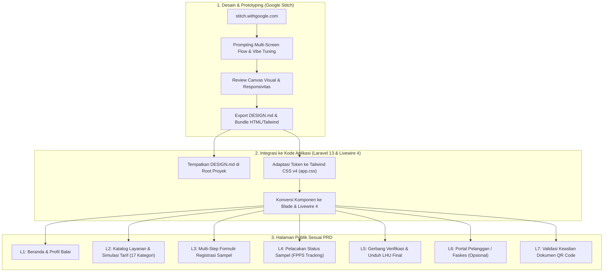

# RENCANA AKSI DESAIN FRONTEND & HALAMAN PENGGUNA PUBLIK
## Perancangan Antarmuka Publik Sistem Informasi Laboratorium Balai Labkesmas Ambon Menggunakan Google Stitch

| Informasi Dokumen | Keterangan |
|---|---|
| **Topik Proyek** | Perancangan Antarmuka Publik (Front-End & Portal Pelanggan) Balai Laboratorium Kesehatan Masyarakat Ambon |
| **Alat Perancangan (AI Prototyping)** | **Google Stitch** ([https://stitch.withgoogle.com/](https://stitch.withgoogle.com/)) |
| **Dokumen Sumber** | [PRD_dan_Desain_Basis_Data.md](file:///home/kurnia/HTDOCS/app-publik/PRD_dan_Desain_Basis_Data.md) & [RENCANA_AKSI_FILAMENT_V5.md](file:///home/kurnia/HTDOCS/app-publik/RENCANA_AKSI_FILAMENT_V5.md) |
| **Target Teknologi Implementasi** | Laravel 13.x, Livewire 4.x, Tailwind CSS v4.x, Alpine.js, PostgreSQL |
| **Model Pengguna** | Publik / Pelanggan Mandiri (`customers`), Faskes, Instansi Pemerintah/Swasta, Masyarakat Umum |
| **Output Akhir** | Visual Prototype di Canvas Stitch, Spesifikasi `DESIGN.md`, Bundle Komponen HTML/Tailwind, dan Modul Blade/Livewire |

---

## 1. Latar Belakang & Tujuan Arsitektur

Dokumen ini merupakan panduan strategis dan teknis untuk merancang seluruh antarmuka depan (*front-end*) yang diakses oleh masyarakat umum, pemohon uji, instansi, dan fasilitas kesehatan (Faskes) untuk **Balai Laboratorium Kesehatan Masyarakat (Labkesmas) Ambon**.

Berbeda dengan antarmuka internal pegawai berbasis Filament v5 (`/admin`) yang telah dipetakan pada [RENCANA_AKSI_FILAMENT_V5.md](file:///home/kurnia/HTDOCS/app-publik/RENCANA_AKSI_FILAMENT_V5.md), modul publik ini berfokus pada:
1. **Kemudahan Akses (Accessibility & User Experience)**: Masyarakat dan perwakilan Faskes dapat dengan mudah mencari informasi layanan laboratorium kesehatan dan lingkungan, mengecek tarif resmi, mendaftarkan sampel secara online, serta melacak progres pengujian tanpa kendala teknis.
2. **Keamanan & Perlindungan Privasi Data Klinis**: Sesuai amanat [PRD_dan_Desain_Basis_Data.md](file:///home/kurnia/HTDOCS/app-publik/PRD_dan_Desain_Basis_Data.md), hasil uji dan dokumen Laporan Hasil Uji (LHU) bersifat rahasia dan **tidak boleh dibuka melalui tautan publik bebas**. Pelacakan status hanya menampilkan progres non-klinis, sedangkan pengunduhan LHU final mewajibkan otentikasi ganda (Pencocokan **Nomor FPPS** + **Nomor HP Pemohon Terdaftar**).
3. **Pemanfaatan Google Stitch (`stitch.withgoogle.com`)**: Mengadopsi teknologi AI design canvas terkini dari Google Labs untuk melakukan *vibe designing*, menghasilkan multi-screen flow interaktif, mengekstrak token desain ke dalam format standar **`DESIGN.md`**, serta mengekspor komponen HTML & Tailwind CSS yang siap diintegrasikan ke dalam ekosistem Laravel 13 dan Livewire 4.



---

## 2. Pemetaan Kebutuhan Halaman Publik (Berdasarkan PRD)

Mengacu pada Bab 2, Bab 3, dan Bab 6 pada [PRD_dan_Desain_Basis_Data.md](file:///home/kurnia/HTDOCS/app-publik/PRD_dan_Desain_Basis_Data.md), terdapat **7 (tujuh) layar antarmuka publik** yang wajib dirancang:

| Kode Layar | Nama Layar | Deskripsi & Komponen Kunci | Entitas Basis Data Terkait |
|---|---|---|---|
| **SCR-01** | **Landing Page / Beranda Publik** | Hero section dengan CTA cepat (*Lacak Sampel*, *Katalog Uji*, *Pendaftaran Online*), keunggulan akreditasi Balai Labkesmas Ambon, 17 ikon kategori layanan, alur 4 langkah mudah, widget FAQ, jam operasional, dan kontak darurat WhatsApp pelayanan. | - |
| **SCR-02** | **Katalog Layanan & Informasi Tarif** | Eksplorasi 17 kelompok layanan (Air Minum, Air Limbah, Makanan, Vektor, Udara, Patologi Klinis, dll.), pencarian parameter instan, filter kategori, rincian syarat volume minimum wadah sampel, estimasi waktu penyelesaian (SLA hari kerja), dan kalkulator estimasi biaya. | `service_groups`<br>`service_packages`<br>`test_parameters`<br>`tariffs`<br>`sample_types`<br>`completion_estimates` |
| **SCR-03** | **Pendaftaran Online Permohonan Uji (Wizard)** | Formulir bertahap 5 langkah: (1) Profil Pemohon (Perorangan/Instansi/Faskes), (2) Pemilihan Kelompok Layanan & Parameter Uji, (3) Rincian Sampel & Titik Sampling, (4) Konfirmasi & Metode Pengiriman Sampel (Loket langsung vs Kurir/Ekspedisi), (5) Penerbitan Nomor Permohonan & Nomor FPPS resmi beserta instruksi pembayaran. | `customers`<br>`test_requests`<br>`test_request_parameters`<br>`test_request_documents`<br>`samples` |
| **SCR-04** | **Lacak Status Sampel (FPPS Tracker)** | Input pencarian Nomor FPPS, visualisasi stepper status terkini (*Didaftarkan -> Sampel Diterima/Ditolak -> Pengujian -> Validasi -> LHU Terbit*), estimasi waktu selesai, riwayat catatan tindak lanjut publik, dan tombol unduh bukti progres. | `test_requests`<br>`status_histories`<br>`sample_receipts` |
| **SCR-05** | **Verifikasi & Unduh Dokumen LHU Final** | Halaman gerbang privasi: Verifikasi kecocokan **Nomor FPPS** + **Nomor HP Pemohon Terdaftar**. Menampilkan preview metadata LHU (nomor surat, tanggal terbit, nama verifikator/validator), serta tombol unduh file PDF LHU resmi berstempel digital. | `test_requests`<br>`customers` (`phone_hash`)<br>`test_reports`<br>`document_access_logs` |
| **SCR-06** | **Portal Pelanggan / Dashboard Faskes (Opsional)** | Area login khusus untuk pemohon rutin (Faskes, Dinas Kesehatan, Instansi Peneliti, Industri). Menampilkan daftar riwayat pengujian masa lalu, status invoice/pembayaran, dan arsip dokumen LHU. | `customers`<br>`test_requests`<br>`payments`<br>`test_reports` |
| **SCR-07** | **Verifikasi Publik Dokumen LHU (Scan QR Code)** | Halaman publik yang muncul saat QR Code pada lembar fisik LHU dipindai. Menampilkan status keabsahan dokumen: "Dokumen Resmi Terverifikasi", nomor sertifikat, tanggal pengesahan, dan identitas pengesah resmi tanpa membocorkan data klinis rahasia. | `test_reports`<br>`test_requests` |

---

## 3. Desain Sistem & Identitas Visual (Design Tokens)

Untuk menjaga keselarasan dengan identitas Kementerian Kesehatan dan Balai Laboratorium Kesehatan Masyarakat Ambon, perancangan di Google Stitch menggunakan acuan token berikut:

### 3.1 Palet Warna (Color Palette)
- **Primary (Emerald / Teal - Nuansa Laboratorium & Kesehatan Lingkungan)**:
  - Base: `#0D9488` (Teal 600)
  - Dark / Brand: `#0F766E` (Teal 700)
  - Hover: `#115E59` (Teal 800)
  - Light Accent: `#CCFBF1` (Teal 100)
- **Secondary (Deep Navy / Slate - Kewibawaan Institusi & Kepercayaan Publik)**:
  - Base: `#0F172A` (Slate 900)
  - Surface Card: `#1E293B` (Slate 800 - dark) / `#F8FAFC` (Slate 50 - light)
- **Accent (Sky Blue - Elemen Informasi Medis & Progres Air Bersih)**:
  - `#0284C7` (Sky 600)
- **Status Alerts (Sesuai Konvensi Medis & Standar PRD)**:
  - Success (Diterima / LHU Terbit): `#16A34A` (Green 600)
  - Warning (Perlu Konfirmasi / Sedang Validasi): `#D97706` (Amber 600)
  - Danger (Sampel Ditolak / Dibatalkan): `#DC2626` (Red 600)
  - Info / Netral: `#475569` (Slate 600)

### 3.2 Tipografi & Tata Letak (Typography & Layout)
- **Font Utama**: *Plus Jakarta Sans* atau *Inter* (Google Fonts) untuk teks bersih, modern, dan keterbacaan tinggi di layar smartphone.
- **Hierarki Teks**:
  - Display / Hero: Bold 36px - 48px
  - H1 / Section Title: Semi-Bold 28px - 32px
  - H2 / Card Title: Semi-Bold 20px - 24px
  - Body Text: Regular 15px - 16px (Leading 1.6)
  - Caption / Label Meta: Medium 12px - 13px
- **Layout Style**: *Bento Grid Layout*, card dengan sudut lengkung halus (`rounded-2xl`), *subtle shadow* (`shadow-sm` hingga `shadow-md`), serta aksen *glassmorphism* lembut pada navigasi *sticky header*.

---

## 4. Panduan Operasional Google Stitch (`stitch.withgoogle.com`)

Google Stitch bekerja dengan memproses *prompt* berbasis bahasa alami dan konteks visual untuk menghasilkan prototipe antarmuka di atas *infinite canvas*.

### 4.1 Persiapan Awal di Google Stitch
1. Buka peramban dan akses: [https://stitch.withgoogle.com/](https://stitch.withgoogle.com/).
2. Masuk menggunakan akun Google yang memiliki akses Google Labs.
3. Buat *Project* baru dengan judul: **`Labkesmas Ambon - Public Web Portal`**.
4. Tetapkan konfigurasi proyek:
   - **Target Platform**: Responsive Web (Desktop 1440px & Mobile 390px).
   - **Framework Output**: HTML5 & Tailwind CSS.
   - **Theme Tone**: Trustworthy, clinical authority, accessible government healthcare, modern bento-grid.

---

## 5. Master Prompt Google Stitch Per Layar (Siap Salin & Tempel)

Berikut adalah kumpulan *prompt* terstruktur dan teruji untuk dijalankan di Google Stitch guna menghasilkan ke-7 layar publik secara konsisten:

### 5.1 Prompt Layar 1: Landing Page & Beranda Publik (`SCR-01`)

```text
Create a modern, highly trustworthy, responsive homepage for a government public health and environmental testing laboratory named "Balai Laboratorium Kesehatan Masyarakat Ambon (Balai Labkesmas Ambon)".

Design language: Clean healthcare aesthetic, primary colors in deep teal (#0F766E) and crisp emerald, slate accents (#0F172A), soft neutral background (#F8FAFC), modern typography using Plus Jakarta Sans, rounded-2xl containers, subtle borders, and smooth shadows.

Include the following sections on a desktop web layout with mobile responsiveness:
1. Navigation Bar: Official Labkesmas Ambon logo placeholder, menu links (Beranda, Katalog Layanan, Lacak Sampel, Pendaftaran Online, Panduan, Kontak), and a high-contrast CTA button "Lacak Hasil FPPS".
2. Hero Section:
   - Catchy headline: "Layanan Pengujian Laboratorium Kesehatan & Lingkungan Terakreditasi di Maluku"
   - Subheadline explaining laboratory testing for water, food, vector, air, and clinical samples with official digital certification.
   - Dual Search Card: (A) Quick FPPS Tracker input field with "Lacak Sekarang" button; (B) Search service catalog bar.
   - Trust badges: Akreditasi KAN, Standar Pelayanan Kemenkes RI, Layanan Cepat & Akurat.
3. Key Services Bento-Grid: Highlighting 6 core test groups: Air Bersih & Minum, Makanan & Minuman, Udara & Emisi, Vektor Penyakit, Patologi Klinis, and Kalibrasi Alat. Each card features clean iconography, test parameter samples, SLA badge ("10 Hari"), and "Lihat Detail" link.
4. 4-Step How It Works Section: (1) Ajukan Permohonan Online, (2) Serahkan/Kirim Sampel Fisik, (3) Uji Laboratorium & Validasi Ahli, (4) Unduh LHU Terverifikasi Digital.
5. Quick Notice Banner: Explaining sample delivery protocols (walk-in counter vs courier cold-chain).
6. Footer: Address in Ambon, customer service WhatsApp button, operational hours, FAQ links, and privacy statement.
```

---

### 5.2 Prompt Layar 2: Katalog Layanan & Simulasi Tarif (`SCR-02`)

```text
Design a comprehensive, user-friendly interactive Service Catalog & Pricing Page for "Balai Laboratorium Kesehatan Masyarakat Ambon".

Design style: Clinical, transparent, clean bento-grid, emerald & teal accents, intuitive search & multi-category filtering.

Include:
1. Top Filter Header:
   - Search bar: "Cari parameter uji (mis. pH, Coliform, Boraks, Logam Berat, dll.)"
   - Category Pills / Tabs for 17 service groups: Air Laut, Air Limbah Domestik, Air Limbah Faskes, Vektor, Makanan, Swab Alat, Air Bersih, Air Sungai, Air Kolam Renang, Bakteriologi Udara, Udara Ambien, Udara Ruangan, Patologi Klinis, Air Minum, Penelitian, Mikrobiologi/Biomolekuler, Kalibrasi.
2. Interactive Catalog Grid (Cards):
   - Card Header: Category badge, Service Name (e.g. "Pemeriksaan Kualitas Air Minum Lengkap").
   - Parameter Pills: List of included parameters (Bau, Kekeruhan, pH, Nitrit, E. Coli, Timbal).
   - Sample Requirements Box: Minimum volume (e.g., "1000 mL dalam wadah steril khusus"), preservation note ("Kondisi dingin 4°C").
   - Estimated SLA Badge: "Estimasi 8-10 Hari Kerja".
   - Official Tariff: Highlighted price tag (e.g., "Rp 503.000").
   - Action Button: "Pilih & Ajukan Uji" (CTA button that adds item to online request draft).
3. Sticky Cost Estimation Summary Drawer / Bottom Sheet:
   - Displays selected services/parameters count, estimated total nominal in Rupiah, and a prominent button: "Lanjutkan ke Pendaftaran Online ->".
```

---

### 5.3 Prompt Layar 3: Formulir Pendaftaran Permohonan Pengujian Online (`SCR-03`)

```text
Design a 5-step responsive Wizard Form for laboratory test sample registration for "Balai Labkesmas Ambon".

Visual tone: Reassuring, structured, distraction-free layout with progress stepper bar at the top, clear validation indicators, and accessible inputs.

The 5 Steps Stepper:
1. Step 1 - Profil Pemohon:
   - Radio selector: Kategori Pemohon [Perorangan | Instansi / Swasta | Fasilitas Kesehatan (Faskes)].
   - Inputs: Nama Lengkap Pemohon, Nama Instansi/Puskesmas/Klinik, Nomor WhatsApp aktif (with warning: "Digunakan untuk verifikasi unduh LHU"), Alamat Email, Alamat Lengkap.
2. Step 2 - Pilihan Layanan & Parameter:
   - Dropdown Kelompok Layanan (e.g., Air Bersih, Makanan, Swab Alat).
   - Selection mode: Paket Pemeriksaan Standar OR Pilihan Parameter Kustom (checklist with individual item tariffs).
   - Real-time running total price calculation card.
3. Step 3 - Informasi Sampel & Titik Sampling:
   - Inputs: Nama/Identitas Sampel, Titik/Lokasi Pengambilan Sampel, Tanggal & Jam Pengambilan (Sampling Date), Jumlah Wadah / Volume.
   - File upload dropzone: Upload Surat Permohonan / Surat Pengantar Tugas (PDF/JPG max 5MB).
4. Step 4 - Metode Penyerahan Sampel & Persetujuan:
   - Choice: [Diantar Langsung ke Loket Balai di Ambon] OR [Dikirim via Ekspedisi / Kurir Rantai Dingin].
   - Guidelines on sample packaging requirements.
   - Mandatory Checkbox: "Saya menyatakan bahwa sampel diambil sesuai standar dan informasi yang diberikan adalah benar."
5. Step 5 - Konfirmasi & Bukti Pendaftaran (Success Receipt Screen):
   - Big success checkmark.
   - Display Generated FPPS Number (e.g., "FPPS-2026-AMB-0142") and Request Number.
   - QR Code for counter quick-scan.
   - Instructions: Payment confirmation via bank transfer/counter and steps to package samples with label.
   - Action buttons: "Cetak Bukti Pendaftaran (PDF)" and "Lacak Progres Sampel".
```

---

### 5.4 Prompt Layar 4: Lacak Status Sampel Publik / FPPS Tracker (`SCR-04`)

```text
Design an intuitive, high-transparency Public Sample Tracking Page for "Balai Laboratorium Kesehatan Masyarakat Ambon".

Design style: Trustworthy status dashboard, sleek progress steppers, timeline cards, teal and slate color scheme.

Key Components:
1. Search Bar Header:
   - Large prominent search card: "Masukkan Nomor FPPS Anda (Contoh: FPPS-2026-AMB-0142)".
   - Clean "Lacak Sampel" button with loading state.
2. Tracking Result Container (When FPPS is Found):
   - Header Card: Nomor FPPS, Jenis Layanan (e.g., Uji Air Bersih), Tanggal Masuk, Status Terkini Badge (e.g. "Sedang Dalam Pengujian Laboratorium" in Teal/Sky badge).
   - Target Selesai (SLA): "Estimasi Selesai: 24 Oktober 2026".
3. Horizontal / Vertical Progress Stepper:
   - Step 1: Pendaftaran Permohonan (Completed - Date & Time)
   - Step 2: Konfirmasi Pembayaran & Verifikasi Syarat (Completed)
   - Step 3: Penerimaan Sampel Fisik di Balai (Completed: "Diterima - Kondisi Baik & Volume Cukup")
   - Step 4: Proses Pengujian Laboratorium (Active state with pulse animation: "Sedang diuji oleh Analis Lab Air & Lingkungan")
   - Step 5: Validasi Manager Lab & Pengesahan Hasil (Pending)
   - Step 6: Laporan Hasil Uji (LHU) Terbit (Pending)
4. Public Note Section: Clarifies that detailed clinical data and parameters are kept confidential until LHU is officially finalized and verified.
5. Action Button: "Unduh Bukti Progres Saat Ini" (PDF progress receipt) and "Verifikasi untuk Unduh LHU Final" (leads to dual-factor download page).
```

---

### 5.5 Prompt Layar 5: Gerbang Verifikasi & Unduh LHU Final (`SCR-05`)

```text
Design a secure Dual-Verification Download Gate for official Laboratory Test Reports (LHU) for "Balai Laboratorium Kesehatan Masyarakat Ambon".

Design style: High-security feel, clean government portal, confidential data protection notice, clear authentication feedback.

Components:
1. Security Notice Card:
   - Shield icon with text: "Perlindungan Kerahasiaan Data Hasil Uji. Berdasarkan kebijakan privasi Balai Labkesmas Ambon, dokumen Laporan Hasil Uji (LHU) hanya dapat diunduh oleh pemilik sampel yang sah."
2. Verification Card:
   - Input 1: Nomor FPPS (Pre-filled or manual input, e.g. "FPPS-2026-AMB-0142").
   - Input 2: Nomor WhatsApp / Telepon Pemohon yang terdaftar saat registrasi (formatted phone input +62).
   - Security ReCAPTCHA placeholder.
   - Button: "Verifikasi & Buka Dokumen LHU".
3. Success Document Preview Card (Shown after matching FPPS + Phone Hash):
   - Certificate preview banner: "Dokumen Laporan Hasil Uji Resmi Siap Diunduh".
   - Document Metadata: Nomor LHU (e.g., "LHU/042/LK-AMB/X/2026"), Tanggal Pengesahan, Nama Pemohon / Instansi, Validator Resmi (Nama & Gelar Kepala Balai/Validator).
   - Document Integrity Stamp: "Dilengkapi Tanda Tangan Elektronik & Segel Pengaman QR Code".
   - Primary Action Button: "Unduh Dokumen LHU (PDF Resmi)" with download icon.
   - Secondary Button: "Unduh Ringkasan Riwayat Progres".
4. Support Contact: WhatsApp Helpdesk link for assistance if phone number does not match registered data.
```

---

### 5.6 Prompt Layar 6: Portal Akun Pelanggan / Faskes Dashboard (`SCR-06`)

```text
Design a dedicated Customer Portal Dashboard for regular healthcare facilities (Puskesmas, Hospitals, Clinics) and Enterprise Clients of "Balai Labkesmas Ambon".

Design layout: Responsive client dashboard with a clean sidebar/topbar navigation, stats summary, and interactive data table.

Key Components:
1. Top Header: Faskes Name (e.g., "RSUD Dr. M. Haulussy Ambon"), Customer Type Badge ("Instansi Rumah Sakit"), Profile avatar, and Logout button.
2. Quick Metrics Row:
   - Metric 1: Permohonan Aktif (e.g. 4 Sampel Sedang Diuji).
   - Metric 2: LHU Siap Unduh (e.g. 12 Dokumen Final).
   - Metric 3: Total Pengujian Tahun Ini (e.g. 48 Permohonan).
3. Primary Action Bar:
   - Button "+ Buat Permohonan Uji Baru" (links directly to registration wizard).
   - Filter dropdown by service category and status (Menunggu Sampel, Pengujian, Lunas, Selesai).
4. Request History Table:
   - Columns: Tanggal, No. FPPS, Nama Sampel/Lokasi, Kelompok Layanan, Status Progres (colored badges), Dokumen LHU (Direct download button if final, or disabled pill "Dalam Proses"), dan Opsi Detail.
5. Invoicing & Billing Summary Card: Displaying pending payments and downloaded official e-receipts.
```

---

### 5.7 Prompt Layar 7: Halaman Verifikasi Publik Keaslian LHU via QR Code (`SCR-07`)

```text
Design a Public Document Authenticity Verification Page that opens when scanning the QR Code printed on an official test report document of "Balai Laboratorium Kesehatan Masyarakat Ambon".

Design style: Official document verification badge, green checkmark seal of authenticity, responsive mobile-first view.

Key Elements:
1. Verification Seal Header:
   - Animated green checkmark badge: "DOKUMEN RESMI TERVERIFIKASI".
   - Subtext: "Dokumen ini terdaftar secara sah di Sistem Informasi Laboratorium Balai Labkesmas Ambon."
2. Document Identification Card:
   - Nomor LHU: LHU/042/LK-AMB/X/2026
   - Nomor FPPS: FPPS-2026-AMB-0142
   - Tanggal Diterbitkan: 20 Oktober 2026
   - Nama Pemohon / Instansi: Dinas Kesehatan Kota Ambon
   - Jenis Pemeriksaan: Mikrobiologi & Kimia Air Bersih
3. Official Signatories & Validation:
   - Disahkan oleh: Validator Resmi Laboratorium & Kepala Balai Labkesmas Ambon.
   - Status Integritas: "Tervalidasi secara elektronik & tidak mengalami perubahan sejak diterbitkan."
4. Privacy Disclaimer:
   - "Rincian angka dan nilai parameter hasil uji tidak ditampilkan secara terbuka demi menjaga kerahasiaan data medis/pengujian sesuai undang-undang."
```

---

## 6. Standar Spesifikasi `DESIGN.md` Hasil Google Stitch

Setelah proses *vibe designing* dan generasi prototipe di Stitch selesai, Stitch mengekstrak sistem desain ke dalam file **`DESIGN.md`**. File ini ditempatkan di root proyek sebagai acuan tunggal (*single source of truth*) dalam pengembangan kode frontend Laravel Blade dan Livewire 4.

Struktur file `DESIGN.md` yang harus diekspor:

```markdown
# DESIGN SYSTEM SPECIFICATION: BALAI LABKESMAS AMBON (PUBLIC PORTAL)

## 1. Brand Identity & Color Tokens
- **Primary Teal**: 
  - `teal-600`: #0D9488 (Interactive elements, primary buttons)
  - `teal-700`: #0F766E (Brand primary, navbar headers, active borders)
  - `teal-800`: #115E59 (Hover states, high contrast text)
  - `teal-50`:  #F0FDFA (Light backgrounds, badge accents)
- **Secondary Slate**:
  - `slate-900`: #0F172A (Primary headings, dark hero elements)
  - `slate-800`: #1E293B (Card borders, secondary headers)
  - `slate-600`: #475569 (Body text, subtext)
  - `slate-100`: #F1F5F9 (Dividers, light container fills)
  - `slate-50`:  #F8FAFC (Global page background)
- **Semantic Accents**:
  - Success: `emerald-600` (#059669) - Validated, accepted, final LHU
  - Warning: `amber-500` (#F59E0B) - In progress, pending payment
  - Danger: `red-600` (#DC2626) - Rejected sample, unverified input
  - Info: `sky-600` (#0284C7) - Notes, laboratory advice

## 2. Typography
- **Font Family**: 'Plus Jakarta Sans', system-ui, sans-serif
- **Scale**:
  - Hero Display: `text-4xl lg:text-5xl font-extrabold tracking-tight`
  - Page Title: `text-2xl lg:text-3xl font-bold text-slate-900`
  - Section Header: `text-xl font-semibold text-slate-800`
  - Card Title: `text-lg font-semibold text-slate-800`
  - Body: `text-base text-slate-600 leading-relaxed`
  - Small / Meta: `text-xs lg:text-sm text-slate-500 font-medium`

## 3. UI Component Specifications
- **Cards**: `bg-white rounded-2xl border border-slate-200/80 shadow-sm hover:shadow-md transition-all duration-200`
- **Buttons Primary**: `bg-teal-700 hover:bg-teal-800 text-white font-medium px-5 py-2.5 rounded-xl shadow-sm transition-all focus:ring-4 focus:ring-teal-700/20`
- **Buttons Secondary**: `bg-white hover:bg-slate-50 text-slate-700 font-medium px-5 py-2.5 rounded-xl border border-slate-300 transition-all`
- **Form Inputs**: `w-full rounded-xl border-slate-300 text-slate-900 placeholder:text-slate-400 focus:border-teal-600 focus:ring-teal-600/20 text-sm py-2.5 px-3.5`
- **Status Stepper**: Circular step numbers with connected lines (`bg-teal-600` for active/completed, `bg-slate-200` for upcoming).
```

---

## 7. Rencana Aksi Eksekusi Bertahap (Fase 1 s.d. Fase 5)

Berikut adalah *roadmap* langkah demi langkah mulai dari perancangan di Google Stitch hingga deployment kode frontend di Laravel:

```
[Fase 1: Inisialisasi Google Stitch]
   │
   ▼
[Fase 2: Generasi Prototipe 7 Layar di Stitch Canvas]
   │
   ▼
[Fase 3: Review Responsivitas & Export DESIGN.md + HTML Bundle]
   │
   ▼
[Fase 4: Transformasi Kode ke Laravel 13, Livewire 4 & Tailwind v4]
   │
   ▼
[Fase 5: Validasi Integritas, Keamanan Privasi & Pengujian Responsif]
```

### 7.1 Fase 1: Inisialisasi Proyek di Google Stitch
- [ ] Buka peramban dan navigasikan ke `https://stitch.withgoogle.com/`.
- [ ] Buat ruang kerja (*workspace*) baru dengan nama **`Labkesmas-Ambon-Public`**.
- [ ] Masukkan instruksi *Design Vibe & Identity* (Nuansa Kemenkes, akreditasi lab medis, warna Teal/Emerald & Navy Slate).
- [ ] Tentukan target rasio layar: *Desktop 1440px* untuk penjelajahan katalog mendalam dan *Mobile View 390px* untuk kemudahan pelacakan lewat smartphone pemohon.

### 7.2 Fase 2: Generasi & Fine-Tuning Prototipe (7 Layar)
- [ ] **Layar 1 (Landing Page)**: Jalankan prompt SCR-01; pastikan CTA *Lacak FPPS* dan *Katalog Layanan* sangat kontras dan langsung terlihat di *fold* pertama.
- [ ] **Layar 2 (Katalog Layanan)**: Jalankan prompt SCR-02; tinjau representasi 17 kelompok layanan, pastikan card menampilkan parameter uji, syarat wadah, volume minimum, estimasi SLA, dan tarif.
- [ ] **Layar 3 (Wizard Pendaftaran Online)**: Jalankan prompt SCR-03; pastikan alur 5 langkah memiliki transisi yang logis dari identitas pemohon hingga layar sukses penerbitan nomor FPPS sementara.
- [ ] **Layar 4 (Lacak Status FPPS)**: Jalankan prompt SCR-04; verifikasi indikator progres tahapan (*stepper*) dari registrasi, penerimaan sampel, pengujian, hingga validasi.
- [ ] **Layar 5 (Verifikasi & Unduh LHU)**: Jalankan prompt SCR-05; validasi konsep otentikasi ganda (Nomor FPPS + Nomor HP) untuk perlindungan kerahasiaan data sesuai PRD.
- [ ] **Layar 6 (Dashboard Faskes/Instansi)**: Jalankan prompt SCR-06; susun tata letak tabel riwayat uji dan metrik ringkas permohonan.
- [ ] **Layar 7 (Verifikasi Keaslian QR)**: Jalankan prompt SCR-07; pastikan visual segel keabsahan resmi meyakinkan dan ramah perangkat seluler.

### 7.3 Fase 3: Ekspor Aset & Spesifikasi Desain
- [ ] Lakukan *walkthrough* interaktif di Stitch canvas untuk memastikan konsistensi warna, *padding*, ukuran font, dan *hover states*.
- [ ] Ekspor file spesifikasi **`DESIGN.md`** dari Stitch dan simpan di root proyek aplikasi (`/home/kurnia/HTDOCS/app-publik/DESIGN.md`).
- [ ] Ekspor bundle kode frontend (HTML, Tailwind utility classes, icon SVG) dari Stitch ke dalam folder arsip proyek.

### 7.4 Fase 4: Integrasi ke Laravel 13, Livewire 4 & Tailwind CSS v4
- [ ] **Konfigurasi CSS**: Perbarui `resources/css/app.css` dengan token warna Teal & Slate yang telah disepakati dari `DESIGN.md`.
- [ ] **Pembuatan Layout Utama Publik**: Buat file layout `resources/views/components/layouts/public.blade.php` lengkap dengan *navbar responsive*, *sticky header*, dan *footer resmi Balai Labkesmas Ambon*.
- [ ] **Pembuatan Komponen Blade Reusable** (`resources/views/components/public/`):
  - `status-badge.blade.php` (menampilkan badge status permohonan)
  - `stepper.blade.php` (komponen visual progress bar alur uji)
  - `service-card.blade.php` (kartu katalog layanan & tarif)
  - `fpps-input.blade.php` (input pencarian FPPS dengan validasi)
- [ ] **Implementasi Full-Page Livewire 4 Components** (`app/Livewire/Public/`):
  - `App\Livewire\Public\LandingPage` (`routes/web.php` -> `/`)
  - `App\Livewire\Public\ServiceCatalog` (`/layanan`)
  - `App\Livewire\Public\RegistrationWizard` (`/daftar-uji`)
  - `App\Livewire\Public\SampleTracking` (`/lacak-sampel`)
  - `App\Livewire\Public\ReportDownloadGate` (`/unduh-lhu`)
  - `App\Livewire\Public\DocumentQrVerification` (`/verifikasi-lhu/{hash}`)
  - `App\Livewire\Customer\CustomerDashboard` (`/portal-pelanggan`) dengan guard `customer`.
- [ ] **Penyambungan ke Model Eloquent & Basis Data**:
  - Hubungkan katalog layanan dengan model `ServiceGroup`, `ServicePackage`, `TestParameter`, `Tariff`, dan `SampleType`.
  - Hubungkan formulir pendaftaran dengan pembuatan transaksi `Customer`, `TestRequest`, `TestRequestParameter`, dan `StatusHistory`.
  - Hubungkan pelacakan dan unduhan dengan verifikasi `phone_hash` dan akses file PDF `TestReport` di penyimpanan privat.

### 7.5 Fase 5: Pengujian Kualitas, Privasi, & Responsivitas
- [ ] **Uji Responsivitas Mobile**: Uji seluruh alur pada viewport smartphone (375px - 414px) untuk memastikan formulir pendaftaran dan pelacakan nyaman digunakan di perangkat seluler pelanggan.
- [ ] **Uji Otentikasi Ganda LHU**: Pastikan LHU final **tidak dapat diunduh** hanya dengan menebak nomor FPPS, melainkan wajib cocok dengan hash nomor telepon pemohon terdaftar.
- [ ] **Uji Aksesibilitas (WCAG AA)**: Periksa kontras warna teks terhadap latar belakang putih/slate, serta ukuran tombol yang ramah sentuhan (min 44x44 px).
- [ ] **Format Kode**: Jalankan `vendor/bin/pint --dirty --format agent` untuk memastikan seluruh file PHP baru memenuhi standar PSR-12 dan gaya penulisan Laravel.

---

## 8. Matriks Keterhubungan Komponen Frontend dengan Basis Data

Tabel berikut menjadi panduan pengembang saat mengonversi desain visual Stitch ke interaksi data backend Laravel:

```
┌─────────────────────────────────┐       ┌───────────────────────────────────┐
│   Desain Stitch (Frontend)      │ ───>  │   Model Eloquent & Database       │
├─────────────────────────────────┤       ├───────────────────────────────────┤
│ SCR-02: Katalog 17 Layanan      │ ───>  │ ServiceGroup, Tariff, SampleType  │
│ SCR-03: Multi-Step Registration │ ───>  │ Customer, TestRequest, Samples    │
│ SCR-04: FPPS Progress Tracker   │ ───>  │ StatusHistory, SampleReceipt      │
│ SCR-05: LHU Download Gate       │ ───>  │ TestReport (file_path privat)     │
│ SCR-07: QR Authenticity Check   │ ───>  │ TestReport (metadata verifikasi)  │
└─────────────────────────────────┘       └───────────────────────────────────┘
```

| Layar Desain | Elemen Antarmuka Visual | Query & Aksi Eloquent di Backend |
|---|---|---|
| **SCR-02 (Katalog)** | List Kategori, Parameter, Syarat Wadah, & Tarif | `ServiceGroup::with(['sampleTypes', 'testParameters.tariffs'])->where('is_active', true)->get()` |
| **SCR-03 (Registrasi)** | Form Step 1 s.d. 4 & Submit Permohonan | Transaksi DB: `Customer::firstOrCreate(...)`, `TestRequest::create([...])`, `TestRequestParameter::insert(...)`, `StatusHistory::create(['status' => 'pending_receipt'])`. Mengirim notifikasi WhatsApp / Email berisi Nomor FPPS. |
| **SCR-04 (Tracking)** | Form input Nomor FPPS & Visual Timeline | `TestRequest::with('statusHistories', 'sample.sampleReceipt')->where('fpps_number', $fpps)->firstOrFail()`. Menampilkan riwayat tanpa field klinis rahasia. |
| **SCR-05 (Unduh LHU)** | Form input FPPS + Nomor Telepon Pemohon | 1. Hash nomor telepon: `hash('sha256', $inputPhone)`.<br>2. Verifikasi: `Customer::where('phone_hash', $hash)->exists()`.<br>3. Catat audit: `DocumentAccessLog::create(['action' => 'download'])`.<br>4. Streaming file PDF terkontrol dari `Storage::disk('private')`. |
| **SCR-07 (QR Verify)** | Scan QR pada sertifikat LHU | `TestReport::with('testRequest.customer')->where('report_number', $number)->firstOrFail()`. Tampilkan status keaslian, nama pengesah, dan stempel verifikasi. |

---

## 9. Checklist Pelaksanaan & Definisi Selesai (Definition of Done)

Gunakan checklist ini untuk melacak kemajuan implementasi antarmuka publik:

### Tahap Desain (Google Stitch)
- [ ] Proyek `Labkesmas-Ambon-Public` aktif di `stitch.withgoogle.com`.
- [ ] 7 Layar prototipe berhasil digenerate dan tertata rapi di canvas.
- [ ] Iterasi gaya visual telah memenuhi kriteria desain modern (Teal/Slate, Bento-grid, font Plus Jakarta Sans).
- [ ] File `DESIGN.md` telah diekspor dan disimpan di root aplikasi.
- [ ] File HTML/Tailwind komponen telah diarsipkan untuk referensi layout.

### Tahap Kode & Integrasi (Laravel & Livewire)
- [ ] Layout publik `resources/views/components/layouts/public.blade.php` selesai dibuat.
- [ ] Rute publik (`routes/web.php`) terkonfigurasi dengan nama rute baku (`public.home`, `public.catalog`, `public.register`, `public.track`, `public.download`, `public.verify`).
- [ ] Komponen Livewire `RegistrationWizard` mendukung validasi input real-time dan perhitungan biaya dinamis.
- [ ] Komponen Livewire `SampleTracking` menyajikan timeline status dengan visual responsif di smartphone.
- [ ] Gerbang pengunduhan LHU terbukti aman dengan pencocokan ganda (Nomor FPPS + Hash Nomor HP).
- [ ] Seluruh file PHP lolos format standar Laravel Pint (`vendor/bin/pint --dirty --format agent`).
- [ ] Kode terverifikasi bekerja dengan baik di lingkungan server lokal.
