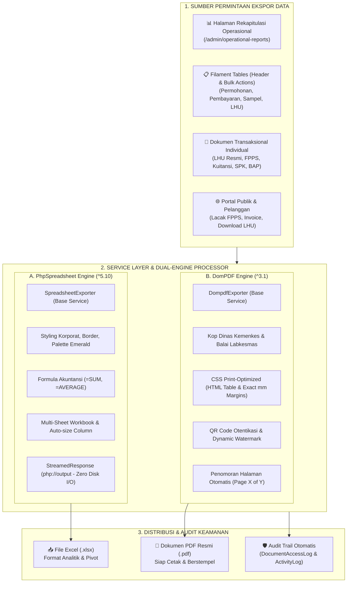
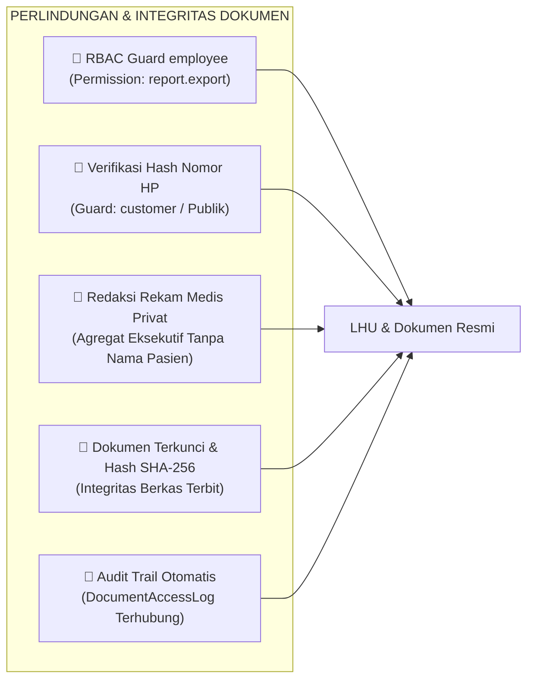
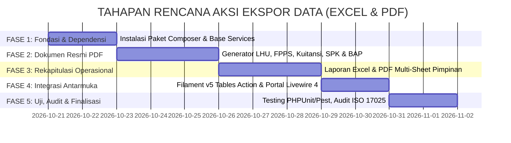

# RENCANA AKSI ARSITEKTUR & IMPLEMENTASI EKSPOR DATA (EXCEL & PDF)
## Sistem Informasi Laboratorium Balai Labkesmas Ambon

| Informasi Dokumen | Keterangan |
|---|---|
| **Topik Dokumen** | Rencana Aksi Perancangan & Implementasi Mesin Ekspor Data (Laporan Operasional, Rekapitulasi Tabel, dan Dokumen Resmi LHU/SPK/Kuitansi) |
| **Pustaka Utama Excel** | [PhpSpreadsheet (phpoffice/phpspreadsheet)](https://phpspreadsheet.readthedocs.io/en/latest/) |
| **Pustaka Utama PDF** | [DomPDF (dompdf/dompdf & barryvdh/laravel-dompdf)](https://github.com/dompdf/dompdf) |
| **Referensi Utama** | [PRD_dan_Desain_Basis_Data.md](file:///home/kurnia/HTDOCS/app-publik/PRD_dan_Desain_Basis_Data.md) |
| **Dokumen Pendukung** | [RENCANA_AKSI_FILAMENT_V5.md](file:///home/kurnia/HTDOCS/app-publik/RENCANA_AKSI_FILAMENT_V5.md) & [RENCANA_AKSI_DASHBOARD.md](file:///home/kurnia/HTDOCS/app-publik/RENCANA_AKSI_DASHBOARD.md) |
| **Framework & Stack** | Laravel 13.x, Filament v5.10.x, Livewire 4.x, Tailwind CSS v4.x, PHP 8.4, PostgreSQL 18 |
| **Sistem Keamanan & Audit** | Spatie RBAC (Guard: `employee` - Permissions: `report.export`, `report.manage`, `audit.view`) & Guard: `customer` (Pencocokan FPPS + Hash Nomor HP) |
| **Target Output File** | [RENCANA_AKSI_EKSPOR_EXCEL_PDF.md](file:///home/kurnia/HTDOCS/app-publik/RENCANA_AKSI_EKSPOR_EXCEL_PDF.md) |

---

## 1. Ringkasan Eksekutif & Prinsip Arsitektur Ekspor Data

Dokumen ini merinci rencana aksi teknis untuk merancang dan membangun **arsitektur mesin ekspor data menyeluruh** pada Sistem Informasi Laboratorium Balai Laboratorium Kesehatan Masyarakat (Labkesmas) Ambon. Modul ini merupakan implementasi langsung dari amanat **PRD Bab 4 (Laporan & Dashboard yang Dibutuhkan)** dan aturan bisnis **Layanan F (Cetak Hasil Uji)** serta **Layanan E (Pengambilan Hasil & Pelacakan Progres)** dari dokumen [PRD_dan_Desain_Basis_Data.md](file:///home/kurnia/HTDOCS/app-publik/PRD_dan_Desain_Basis_Data.md).



### Prinsip Utama Perancangan Mesin Ekspor:
1. **Standar Dokumen Resmi Instansi Pemerintah**:
   Seluruh berkas cetak PDF harus mematuhi format tata naskah dinas Kementerian Kesehatan RI, dilengkapi kop surat resmi Balai Labkesmas Ambon, garis pembatas ganda standar kepemerintahan, informasi akreditasi KAN (Komite Akreditasi Nasional), penomoran dokumen unik, dan blok pengesahan resmi.
2. **Spesialisasi Dua Mesin (*Dual-Engine Specialization*)**:
   - **PhpSpreadsheet** dikhususkan untuk rekapitulasi tabular, agregasi numerik, rumus keuangan, dan analisis data lanjut oleh Pimpinan, Kasir, atau Auditor.
   - **DomPDF** dikhususkan untuk penerbitan dokumen hukum dan operasional siap cetak (A4 portrait/landscape) yang mengutamakan kerapian tipografi, konsistensi margin cetak, dan proteksi integritas isi.
3. **Kerahasiaan Medis & Perlindungan Data Pribadi (UU PDP & ISO 17025)**:
   - Ekspor rekapitulasi operasional massal (agregat) **tidak boleh membocorkan rekam klinis pribadi atau detail patologi pasien** kepada pihak yang tidak memiliki hak akses klinis.
   - LHU individual hanya dapat diunduh oleh pegawai berwenang atau pemohon bersangkutan setelah verifikasi ganda (Nomor FPPS + Hash Nomor HP terdaftar).
4. **Efisiensi Memori & Beban Server (*Zero Disk Clutter & Cursor Streaming*)**:
   - Menghindari pembuatan berkas sementara (*temporary files*) yang menumpuk di disk server untuk ekspor rekapitulasi, dengan memanfaatkan `php://output` dan `StreamedResponse`.
   - Menggunakan Eloquent `cursor()` atau `lazyChunk()` untuk mencegah kehabisan memori (*PHP Memory Limit Exhaustion*) saat mengekspor ribuan baris data.
   - Penyimpanan persisten di disk lokal hanya dilakukan untuk arsip dokumen LHU final yang telah diterbitkan resmi (`storage/app/private/reports/`).
5. **Jejak Audit Otomatis (*Comprehensive Audit Trail*)**:
   Setiap kali dokumen diunduh atau dicetak (terutama LHU), sistem wajib mencatat entri ke model [DocumentAccessLog.php](file:///home/kurnia/HTDOCS/app-publik/app/Models/DocumentAccessLog.php) mencakup identitas aktor (Employee/Customer), IP Address, aksi ([DocumentAccessAction::Download](file:///home/kurnia/HTDOCS/app-publik/app/Enums/DocumentAccessAction.php) / `Print`), dan stempel waktu.

---

## 2. Pemilihan & Spesifikasi Plugin/Pustaka

Berdasarkan analisis kompatibilitas stack (Laravel 13.x dan PHP 8.4), berikut adalah pustaka resmi yang dipilih dan diintegrasikan:

### 2.1 Plugin Ekspor Excel: PhpSpreadsheet
- **Dokumentasi**: [https://phpspreadsheet.readthedocs.io/en/latest/](https://phpspreadsheet.readthedocs.io/en/latest/)
- **Paket Composer**: `phpoffice/phpspreadsheet: ^5.10`
- **Keunggulan Teknis**:
  - Pustaka standar industri berbasis PHP murni untuk membaca dan menulis format spreadsheet XLSX, CSV, ODS, dan XLS.
  - Dukungan manipulasi sel tingkat lanjut: font, garis pembatas (border), warna sel (fill background), alignment vertikal/horizontal, serta text wrapping.
  - Dukungan formula spreadsheet lengkap (`SUM`, `AVERAGE`, `COUNTIF`, dll.) yang langsung dapat dikalkulasi ulang di Microsoft Excel / Google Sheets.
  - Kemampuan membuat berkas multi-lembar kerja (*multi-sheet workbooks*), memungkinkan satu berkas laporan memiliki tab "Ringkasan Eksekutif", tab "Rincian Permohonan", dan tab "Rekapitulasi Finansial".
  - Dukungan *Freeze Panes* (mengunci baris header tabel saat digulir) dan *Auto Filter*.
  - Dukungan *Auto-sizing* lebar kolom berdasarkan panjang konten terpanjang.

### 2.2 Plugin Ekspor PDF: DomPDF
- **Repositori & Dokumentasi**: [https://github.com/dompdf/dompdf](https://github.com/dompdf/dompdf) & [barryvdh/laravel-dompdf](https://github.com/barryvdh/laravel-dompdf)
- **Paket Composer**: `dompdf/dompdf: ^3.1` melalui wrapper Laravel `barryvdh/laravel-dompdf: ^3.1`
- **Keunggulan Teknis**:
  - Konversi langsung dari template HTML/CSS Blade Laravel ke format PDF siap cetak.
  - Kompatibel penuh dengan PHP 8.4 dan Laravel 13.x.
  - Penanganan ukuran kertas fleksibel: A4 Portrait, A4 Landscape, Legal, Letter, hingga Folio F4.
  - Dukungan penomoran halaman dinamis melalui inline script DomPDF (`$pdf->page_text(...)`).
  - Kemampuan menyisipkan gambar logo resmi beresolusi tinggi, barcode/QR Code verifikasi dokumen (format SVG/PNG base64), dan latar belakang stempel digital atau tanda air (*watermark*).
  - Ringan dan tidak memerlukan instalasi dependensi biner pihak ketiga di sistem operasi server (seperti Chrome headless atau wkhtmltopdf).

---

## 3. Taksonomi & Matriks Seluruh Kebutuhan Ekspor Data

Berdasarkan seluruh proses bisnis laboratorium, kebutuhan ekspor dibagi ke dalam **4 Kategori Besar**:

```
├── 📊 KATEGORI A: Laporan Rekapitulasi & Analitik Operasional (Halaman OperationalReports)
│   ├── LAP-01: Rekapitulasi Eksekutif Komprehensif (Multi-sheet Excel & PDF Ringkasan)
│   ├── LAP-02: Rekapitulasi Permohonan Uji & Tracking Status (Excel & PDF Landscape)
│   ├── LAP-03: Rekapitulasi Penerimaan Retribusi & Kas Pelayanan (Excel Finansial & PDF Kuitansi)
│   ├── LAP-04: Rekapitulasi Distribusi 17 Layanan Brosur & Beban Lab (Excel & PDF)
│   ├── LAP-05: Rekapitulasi Kepatuhan SLA & Waktu Penyelesaian / TAT (Excel & PDF)
│   └── LAP-06: Rekapitulasi Penerimaan & Penolakan Fisik Sampel (Excel & PDF Log Mutu)
│
├── 📋 KATEGORI B: Aksi Ekspor Tabel Data Filament v5 (Table Header & Bulk Export)
│   ├── TAB-01: Ekspor Tabel Permohonan (TestRequestsTable)
│   ├── TAB-02: Ekspor Tabel Pembayaran (PaymentsTable)
│   ├── TAB-03: Ekspor Tabel Sampel & Registrasi Fisik (SamplesTable)
│   ├── TAB-04: Ekspor Tabel Laporan Hasil Uji (TestReportsTable)
│   └── TAB-05: Ekspor Tabel Log Akses Dokumen / Audit Trail (DocumentAccessLogsTable)
│
├── 📑 KATEGORI C: Dokumen Transaksional Individual Resmi (PDF Siap Cetak Berstempel)
│   ├── DOC-01: Laporan Hasil Uji (LHU) Resmi Final (Multi-page A4 Portrait Bersertifikasi KAN)
│   ├── DOC-02: Formulir Permintaan Pemeriksaan Sampel / Bukti Registrasi FPPS (A4 Portrait)
│   ├── DOC-03: Kuitansi / Tanda Bukti Bayar Retribusi Pelayanan (A4 / 1/2 A4 Landscape)
│   ├── DOC-04: Surat Perintah Kerja (SPK) Analis Laboratorium (A4 Portrait Kerja Lab)
│   └── DOC-05: Berita Acara Penolakan Sampel Fisik / Sampel Rusak (A4 Portrait Berita Acara)
│
└── 🌐 KATEGORI D: Dokumen Portal Publik Pelanggan (Livewire 4 Frontend)
    ├── PUB-01: Bukti Tanda Terima Permohonan Digital (PDF)
    ├── PUB-02: Bukti Invoice / Kuitansi Lunas Digital (PDF)
    ├── PUB-03: Unduh LHU Final Terverifikasi (FPPS + Nomor HP)
    └── PUB-04: Ekspor Riwayat Permohonan Faskes / Perusahaan (Excel)
```

### Matriks Detail Kebutuhan Dokumen & Format Ekspor:

| Kode | Nama Dokumen / Laporan | Format Output | Mesin Ekspor | Orientasi & Ukuran | Pengguna Sasaran & Hak Akses | Fitur Khusus Dokumen |
|---|---|---|---|---|---|---|
| **LAP-01** | Rekapitulasi Eksekutif Komprehensif | `.xlsx` & `.pdf` | PhpSpreadsheet & DomPDF | A4 Landscape / Multi-sheet | Pimpinan Balai, Koordinator (`leader`, `admin`) | 4 Sheet Excel terpisah, visual kpi, ringkasan per kelompok layanan, tanda tangan Pimpinan. |
| **LAP-02** | Rekapitulasi Permohonan & Sampel | `.xlsx` & `.pdf` | PhpSpreadsheet & DomPDF | A4 Landscape | Petugas Pelayanan, Pimpinan (`service_officer`, `leader`) | Filter tanggal, nomor FPPS, pemohon, kanal (Online/WA/Loket), status bayar & alur. |
| **LAP-03** | Rekapitulasi Penerimaan Retribusi | `.xlsx` & `.pdf` | PhpSpreadsheet & DomPDF | A4 Landscape | Kasir, Bendahara Penerimaan, Pimpinan | Formula `=SUM()`, format IDR, rekapitulasi lunas vs piutang per periode. |
| **LAP-04** | Rekap Distribusi 17 Layanan Brosur | `.xlsx` & `.pdf` | PhpSpreadsheet & DomPDF | A4 Landscape | Pimpinan, Kepala Instalasi Lab | Pemetaan 17 kelompok layanan resmi brosur, volume sampel, estimasi penerimaan retribusi. |
| **LAP-05** | Rekap Kepatuhan SLA & Waktu Uji | `.xlsx` & `.pdf` | PhpSpreadsheet & DomPDF | A4 Landscape | Kepala Balai, Manager Mutu | Analisis TAT (Turnaround Time), persentase tepat waktu vs overdue, identifikasi bottleneck. |
| **LAP-06** | Rekap Penerimaan & Penolakan Sampel | `.xlsx` & `.pdf` | PhpSpreadsheet & DomPDF | A4 Landscape | Petugas Pengambil/Penerima Sampel (`sample_receiver`) | Rasio terima vs tolak, daftar penyebab tolak (volume, suhu, botol pecah), tindak lanjut. |
| **DOC-01** | Laporan Hasil Uji (LHU) Resmi Final | `.pdf` | DomPDF | A4 Portrait | Pegawai Berwenang (`report.manage`), Pemohon Terverifikasi | Kop resmi Kemenkes/Balai, nomor akreditasi KAN, tabel parameter uji & baku mutu, QR Code verifikasi, TTD Kepala Balai, watermark status. |
| **DOC-02** | Bukti Pendaftaran FPPS | `.pdf` | DomPDF | A4 Portrait | Petugas Loket & Pemohon | Barcode/QR Code FPPS, rincian parameter terpilih, target estimasi selesai, syarat pengambilan. |
| **DOC-03** | Kuitansi Pembayaran Retribusi | `.pdf` | DomPDF | 1/2 A4 Landscape | Petugas Kasir & Pemohon | Nomor Kuitansi, nominal terbilang huruf, rincian biaya pengujian, cap lunas, TTD kasir. |
| **DOC-04** | Surat Perintah Kerja (SPK) Analis | `.pdf` | DomPDF | A4 Portrait | Analis Lab & Kepala Instalasi | Lembar instruksi uji per laboratorium (Kimia/Mikro/Patologi), metode acuan SNI, batas waktu pengerjaan. |
| **DOC-05** | Berita Acara Penolakan Sampel | `.pdf` | DomPDF | A4 Portrait | Petugas Sampel & Kurir/Pengantar | Form formal penolakan sampel tidak memenuhi syarat, alasan teknis, tanda tangan para pihak. |

---

## 4. Arsitektur Teknis Service Layer (Clean Architecture)

Untuk menjaga kode tetap bersih, mudah dirawat, dan mematuhi prinsip *Single Responsibility Principle* (SRP), seluruh logika pembuatan berkas diekstraksi ke dalam **Service Layer** khusus di `app/Services/Export/`.

### 4.1 Struktur Direktori Service Layer

```
app/
├── Services/
│   └── Export/
│       ├── Contracts/
│       │   ├── ExcelExporterInterface.php
│       │   └── PdfExporterInterface.php
│       │
│       ├── Excel/
│       │   ├── SpreadsheetExporter.php (Base Class utilitas PhpSpreadsheet)
│       │   ├── OperationalReportExcelExporter.php (Multi-sheet laporan eksekutif)
│       │   ├── TestRequestExcelExporter.php (Rekapitulasi permohonan)
│       │   ├── PaymentExcelExporter.php (Rekapitulasi finansial & retribusi)
│       │   ├── SampleReceiptExcelExporter.php (Rekapitulasi sampel & tolak)
│       │   └── SlaComplianceExcelExporter.php (Rekapitulasi kepatuhan SLA)
│       │
│       └── Pdf/
│           ├── DompdfExporter.php (Base Class konfigurasi DomPDF & Stream)
│           ├── TestReportPdfGenerator.php (Generator LHU resmi dengan QR Code)
│           ├── TestRequestReceiptPdfGenerator.php (Bukti pendaftaran FPPS)
│           ├── PaymentReceiptPdfGenerator.php (Kuitansi retribusi)
│           ├── WorkOrderPdfGenerator.php (SPK Analis Laboratorium)
│           ├── SampleRejectionPdfGenerator.php (Berita acara tolak sampel)
│           └── OperationalReportPdfGenerator.php (Ringkasan eksekutif PDF)
```

### 4.2 Struktur Direktori Blade View Template Ekspor

```
resources/views/
└── exports/
    └── pdf/
        ├── layouts/
        │   ├── official-document.blade.php (Kop dinas, garis ganda, footer nomor halaman)
        │   └── landscape-report.blade.php (Layout tabel data lebar, font 9-10pt)
        │
        ├── documents/
        │   ├── lhu-report.blade.php (Template LHU resmi KAN)
        │   ├── fpps-receipt.blade.php (Bukti registrasi pemohon)
        │   ├── payment-receipt.blade.php (Kuitansi retribusi)
        │   ├── work-order-spk.blade.php (SPK Analis pengujian)
        │   └── sample-rejection.blade.php (Berita acara penolakan sampel)
        │
        └── reports/
            ├── operational-summary.blade.php (Ringkasan eksekutif pimpinan)
            ├── requests-recap.blade.php (Tabel daftar permohonan)
            ├── payments-recap.blade.php (Tabel penerimaan kas)
            ├── samples-recap.blade.php (Tabel status penerimaan sampel)
            └── sla-compliance-recap.blade.php (Tabel evaluasi SLA & TAT)
```

---

## 5. Spesifikasi Teknis Ekspor Excel (PhpSpreadsheet Engine)

### 5.1 Standar Desain & Palet Warna Spreadsheet
Dokumen Excel yang dihasilkan harus terlihat profesional, elegan, dan siap digunakan untuk rapat pimpinan atau audit Badan Pemeriksa Keuangan (BPK):
- **Warna Header Utama**: Deep Teal / Emerald (`#0F766E` / `#065F46`), teks putih tebal (Bold White).
- **Warna Sub-Header / Kolom**: Soft Mint (`#E6F4F1`) atau Light Slate (`#F1F5F9`), teks abu-abu gelap (`#1F2937`).
- **Garis Pembatas (Border)**: Thin border abu-abu lembut (`#CBD5E1`) pada seluruh sel data; Double Bottom Border pada baris Total/Kesimpulan.
- **Font Tipografi**: Aptos, Calibri, atau Segoe UI, ukuran 14pt (Judul Dokumen), 11pt (Metadata/Header), 10pt (Isi Sel Data), 9pt (Catatan Kaki/Stempel Tanggal).

### 5.2 Standar Format Data Numerik & Formula
- **Mata Uang (Rupiah)**:
  ```php
  $sheet->getStyle('F6:F' . $lastRow)
        ->getNumberFormat()
        ->setFormatCode('_("Rp"* #,##0_);_("Rp"* \(#,##0\);_("Rp"* "-"_);_(@_)');
  ```
- **Tanggal & Waktu**:
  ```php
  $sheet->getStyle('C6:C' . $lastRow)
        ->getNumberFormat()
        ->setFormatCode('DD/MM/YYYY HH:MM');
  ```
- **Persentase**:
  ```php
  $sheet->getStyle('H6:H' . $lastRow)
        ->getNumberFormat()
        ->setFormatCode('0.0%');
  ```
- **Rumus Dinamis Otomatis**:
  Menggunakan formula Excel aktif (bukan angka statis hasil PHP) agar jika angka diubah, total otomatis menyesuaikan:
  ```php
  $sheet->setCellValue("F{$lastRow}", "=SUM(F6:F" . ($lastRow - 1) . ")");
  ```

### 5.3 Optimalisasi Memori & Mekanisme Streaming Output
Untuk menghindari pembuatan berkas sementara (*temporary file*) di hard disk server:
```php
namespace App\Services\Export\Excel;

use PhpOffice\PhpSpreadsheet\Spreadsheet;
use PhpOffice\PhpSpreadsheet\Writer\Xlsx;
use Symfony\Component\HttpFoundation\StreamedResponse;

class SpreadsheetExporter
{
    public static function streamResponse(Spreadsheet $spreadsheet, string $filename): StreamedResponse
    {
        return response()->streamDownload(function () use ($spreadsheet) {
            $writer = new Xlsx($spreadsheet);
            $writer->save('php://output');
        }, $filename, [
            'Content-Type' => 'application/vnd.openxmlformats-officedocument.spreadsheetml.sheet',
            'Cache-Control' => 'max-age=0',
        ]);
    }
}
```

### 5.4 Arsitektur Multi-Sheet Workbook untuk Laporan Eksekutif (`LAP-01`)
Satu berkas Excel eksekutif berisi 4 tab terstruktur rapi:
1. **Sheet 1: Ringkasan Eksekutif**:
   - Kartu metrik KPI (Total Permohonan, Total Sampel, Realisasi Retribusi, Kepatuhan SLA %).
   - Distribusi kanal pendaftaran (Web Publik, WhatsApp, Loket).
   - Ringkasan distribusi 17 kelompok layanan.
2. **Sheet 2: Rincian Permohonan (FPPS)**:
   - Data tabular seluruh permohonan dalam rentang tanggal terpilih dengan auto-filter aktif.
3. **Sheet 3: Penerimaan Retribusi**:
   - Rincian transaksi pembayaran, nomor kuitansi, tanggal bayar, kasir pencatat, dan nominal.
4. **Sheet 4: Log Mutu & Penolakan Sampel**:
   - Rincian penerimaan sampel fisik dan daftar penolakan beserta alasan teknis.

---

## 6. Spesifikasi Teknis Ekspor PDF (DomPDF Engine)

### 6.1 Karakteristik & Keterbatasan DomPDF (Aturan Wajib)
> [!IMPORTANT]
> **Aturan Khusus DomPDF v3.1:**
> 1. **DILARANG menggunakan CSS Flexbox (`display: flex`) atau CSS Grid**: DomPDF tidak mendukung flexbox dan grid; layout akan hancur berantakan. Seluruh tata letak kolom, kop surat, dan tabel perbandingan **WAJIB menggunakan elemen `<table>` murni** dengan lebar persentase (`width="100%"`), `cellpadding`, `cellspacing="0"`, dan `style="border-collapse: collapse;"`.
> 2. **Gunakan Font Bawaan Standar**: Gunakan `Helvetica`, `Arial`, atau `Times New Roman` untuk memastikan rendering teks cepat, akurat, dan tidak mengalami masalah kegagalan font UTF-8.
> 3. **Pencegahan Pemotongan Baris Tabel (Page-Break Safety)**:
>    Tambahkan aturan CSS: `tr { page-break-inside: avoid; }` dan `table { page-break-inside: auto; }` agar baris tabel atau tanda tangan tidak terpotong di tengah antar halaman.

### 6.2 Standar Tata Naskah Dinas & Kop Surat Resmi
Setiap dokumen resmi instansi Balai Labkesmas Ambon menggunakan struktur kop standar:

```
┌────────────────────────────────────────────────────────────────────────────────────────┐
│  [LOGO KEMENKES]         KEMENTERIAN KESEHATAN REPUBLIK INDONESIA         [LOGO BALAI] │
│                           DIREKTORAT JENDERAL KESEHATAN MASYARAKAT                     │
│                    BALAI LABORATORIUM KESEHATAN MASYARAKAT AMBON                       │
│             Jl. Wolter Monginsidi, Passo, Kec. Baguala, Kota Ambon, Maluku 97232       │
│               Telepon: (0911) 361234 | Email: labkesmas.ambon@kemkes.go.id             │
│════════════════════════════════════════════════════════════════════════════════════════│
│────────────────────────────────────────────────────────────────────────────────────────│
```

- Baris batas kop surat menggunakan 2 lapis garis: garis tebal atas (2pt) dan garis tipis bawah (0.75pt).

### 6.3 Penomoran Halaman Dinamis (Page X of Y)
Menggunakan script PHP bawaan DomPDF yang dieksekusi saat proses rendering kanvas:
```php
<script type="text/php">
    if (isset($pdf)) {
        $font = $fontMetrics->get_font("Helvetica", "normal");
        $size = 8;
        $pageText = "Halaman {PAGE_NUM} dari {PAGE_COUNT}";
        $y = $pdf->get_height() - 24;
        $x = $pdf->get_width() - 100;
        $pdf->page_text($x, $y, $pageText, $font, $size, [0.3, 0.3, 0.3]);
        
        // Stempel Tanggal Unduh di Kiri Bawah
        $docText = "Dokumen Resmi Balai Labkesmas Ambon | Dicetak: " . date('d/m/Y H:i') . " WIT";
        $pdf->page_text(35, $y, $docText, $font, $size, [0.4, 0.4, 0.4]);
    }
</script>
```

### 6.4 QR Code Verifikasi Dokumen & Tanda Tangan Digital
Pada dokumen LHU (`DOC-01`) dan Bukti Registrasi (`DOC-02`), disematkan QR Code dinamis:
- Menghasilkan tautan verifikasi publik: `https://labkesmasambon.kemkes.go.id/verifikasi/{report_uuid_or_hash}`.
- Siapa pun (dokter, faskes pengirim, atau aparat pengawas) dapat memindai QR Code menggunakan kamera ponsel untuk memverifikasi keaslian LHU langsung dari basis data tanpa login.
- Menggunakan generator barcode/QR Code berbasis SVG/PNG inline base64 tanpa memerlukan koneksi internet server.

### 6.5 Watermark Dokumen Fleksibel
- Jika status LHU masih berstatus `draft`: Disematkan watermark miring besar di latar belakang halaman bertuliskan: **"DRAF - BELUM VALID / TIDAK DAPAT DIGUNAKAN"**.
- Jika status LHU telah berstatus `final`: Disematkan watermark halus stempel resmi Balai Labkesmas Ambon berlogo Kemenkes dengan opasitas 10%.

---

## 7. Integrasi dengan Panel Admin Pegawai (Filament v5)

### 7.1 Integrasi pada Halaman Rekapitulasi Operasional (`OperationalReports.php`)
Pada file [OperationalReports.php](file:///home/kurnia/HTDOCS/app-publik/app/Filament/Pages/OperationalReports.php) dan tampilannya [operational-reports.blade.php](file:///home/kurnia/HTDOCS/app-publik/resources/views/filament/pages/operational-reports.blade.php):
- Menggantikan tombol `window.print()` yang bersifat klien dengan 2 tombol aksi resmi:
  1. **Tombol "Ekspor Excel (.xlsx)"**: Memanggil metode `exportExcel()` yang mengeksekusi `OperationalReportExcelExporter::generate($this->startDate, $this->endDate)` dan mengembalikan `StreamedResponse`.
  2. **Tombol "Unduh Ringkasan PDF (.pdf)"**: Memanggil metode `exportPdf()` yang mengeksekusi `OperationalReportPdfGenerator::generate($this->startDate, $this->endDate)` dan mengunduh berkas ringkasan eksekutif berstempel dinas.

### 7.2 Integrasi Header Actions & Bulk Actions pada Filament Tables
Setiap tabel data operasional dilengkapi aksi ekspor instan yang otomatis menghormati filter pencarian aktif pengguna:

#### A. Permohonan Pengujian ([TestRequestsTable.php](file:///home/kurnia/HTDOCS/app-publik/app/Filament/Resources/TestRequests/Tables/TestRequestsTable.php)):
- **Header Action "Ekspor Excel Permohonan"**: Mengekspor seluruh data yang sesuai dengan filter aktif (misalnya per kelompok layanan atau status bayar tertentu).
- **Bulk Action "Ekspor Baris Terpilih ke Excel"**: Mengekspor hanya baris-baris yang dicentang oleh petugas loket.
- **Record Action "Cetak Lembar FPPS"**: Mengunduh formulir bukti registrasi pemohon [DOC-02].

#### B. Pembayaran & Retribusi ([PaymentsTable.php](file:///home/kurnia/HTDOCS/app-publik/app/Filament/Resources/Payments/Tables/PaymentsTable.php)):
- **Header Action "Ekspor Buku Kas Retribusi"**: Mengekspor rekap penerimaan kas ke Excel dengan formula `=SUM()`.
- **Record Action "Cetak Kuitansi"**: Mengunduh kuitansi resmi bertanda tangan kasir [DOC-03].

#### C. Penerimaan Sampel Fisik ([SamplesTable.php](file:///home/kurnia/HTDOCS/app-publik/app/Filament/Resources/Samples/Tables/SamplesTable.php)):
- **Header Action "Ekspor Log Penerimaan Sampel"**: Rekapitulasi volume sampel masuk dan rasio tolak.
- **Record Action "Cetak Berita Acara Penolakan"**: Muncul hanya jika sampel berstatus `Rejected` [DOC-05].

#### D. Laporan Hasil Uji ([TestReportsTable.php](file:///home/kurnia/HTDOCS/app-publik/app/Filament/Resources/TestReports/Tables/TestReportsTable.php)):
- **Record Action "Unduh LHU PDF Resmi"**: Mengunduh dokumen LHU final resmi [DOC-01]. Otomatis mencatat ke [DocumentAccessLog.php](file:///home/kurnia/HTDOCS/app-publik/app/Models/DocumentAccessLog.php).
- **Record Action "Cetak LHU"**: Membuka LHU di tab browser baru untuk langsung dicetak printer dinas.

---

## 8. Integrasi dengan Portal Publik Pelanggan (Livewire 4)

Sesuai aturan keamanan PRD Bab 3 Layanan E & F:
1. **Lacak Status Permohonan Publik (`/lacak-status`)**:
   - Pelanggan memasukkan Nomor FPPS (contoh: `FPPS-202610-0012`) dan Nomor HP.
   - Sistem mencocokkan nomor HP menggunakan algoritma `hashPhone()` ([Customer.php](file:///home/kurnia/HTDOCS/app-publik/app/Models/Customer.php#L33-L38)) terhadap data pemohon.
2. **Kondisi Akses Unduh Dokumen**:
   - Bukti Pendaftaran (FPPS) & Kuitansi Pembayaran: Dapat diunduh segera setelah permohonan diverifikasi/dibayar.
   - **Laporan Hasil Uji (LHU) Final**: Tombol unduh **HANYA AKTIF** jika status LHU adalah [ReportStatus::Final](file:///home/kurnia/HTDOCS/app-publik/app/Enums/ReportStatus.php) dan status permohonan adalah `completed` atau `report_issued`.
   - Draf LHU atau hasil yang belum divalidasi **SAMA SEKALI TIDAK BOLEH DIBUKA ATAU DIUNDUH OLEH PUBLIK**.
3. **Pencatatan Audit Akses Publik**:
   Setiap kali tombol unduh ditekan oleh pelanggan:
   ```php
   DocumentAccessLog::create([
       'test_report_id' => $report->id,
       'customer_id' => $testRequest->customer_id,
       'employee_id' => null,
       'action' => DocumentAccessAction::Download,
       'ip_address' => request()->ip(),
       'accessed_at' => now(),
   ]);
   ```

---

## 9. Keamanan, Kerahasiaan Medis, Akreditasi ISO 17025, & Audit Trail

Laboratorium Kesehatan Masyarakat terikat pada regulasi kerahasiaan medis Permenkes dan standar akreditasi laboratorium ISO/IEC 17025:2017:



1. **Pemisahan Data Publik vs Privat (Privacy-by-Design)**:
   - File ekspor Excel / PDF yang ditujukan untuk laporan umum dan pimpinan **TIDAK mencantumkan parameter hasil klinis/patologi perseorangan secara telanjang**. Laporan agregat hanya menampilkan jumlah sampel, kategori layanan, dan persentase kepatuhan.
   - Hasil pemeriksaan klinis spesifik perorangan hanya tercetak pada LHU individual yang diserahkan tertutup kepada pemohon sah.
2. **Integritas Dokumen Terbit (Anti-Tampering & Hash Verification)**:
   - Saat LHU final diterbitkan, sistem menghitung checksum hash berkas PDF (SHA-256).
   - Nilai hash ini disimpan pada atribut sistem untuk menjamin bahwa berkas PDF yang beredar tidak pernah mengalami modifikasi sepihak.
3. **Pengesahan Berjenjang Resmi (Chain of Custody)**:
   - Dokumen LHU mencantumkan nama dan NIP Analis pemeriksa, nama dan NIP Validator Teknis (Manager Lab), serta pengesahan Kepala Balai Labkesmas Ambon.

---

## 10. Tahapan Implementasi Bertahap (Roadmap 5 Fase)

Rencana aksi ini dirancang untuk dieksekusi secara terstruktur melalui **5 Fase Implementasi**:



---

### 10.1 Fase 1: Fondasi Pustaka & Core Service Layer
- **Tujuan**: Menyiapkan dependensi pustaka, konfigurasi font, serta fondasi arsitektur *Service Layer* dasar.
- **Daftar Tugas Konkret**:
  1. Menjalankan penambahan dependensi composer:
     ```bash
     composer require phpoffice/phpspreadsheet:^5.10 barryvdh/laravel-dompdf:^3.1
     ```
  2. Menerbitkan file konfigurasi `dompdf.php` menggunakan `php artisan vendor:publish --provider="Barryvdh\DomPDF\ServiceProvider"`.
  3. Mengonfigurasi `config/dompdf.php`:
     - `'enable_font_subsetting' => true`
     - `'enable_remote' => true` (untuk memuat gambar/aset lokal secara aman)
     - `'default_paper_size' => 'a4'`
     - `'default_font' => 'helvetica'`
  4. Membuat kontrak antarmuka di `app/Services/Export/Contracts/`:
     - `ExcelExporterInterface.php`
     - `PdfExporterInterface.php`
  5. Membuat base class utilitas:
     - `SpreadsheetExporter.php`: Penanganan styling baris header, auto-sizing kolom, borders, number format mata uang rupiah, dan generator `StreamedResponse`.
     - `DompdfExporter.php`: Penanganan kanvas PDF, margin halaman standar A4 (margin 15mm), script nomor halaman `page_text`, dan generator `stream()` / `download()`.
  6. Membuat layout Blade master PDF di `resources/views/exports/pdf/layouts/`:
     - `official-document.blade.php`: Kop dinas Kemenkes & Balai Labkesmas Ambon, garis pembatas ganda, styling CSS tabel murni (tanpa flexbox/grid), dan footer dinamis.
     - `landscape-report.blade.php`: Master layout tabel horizontal lebar untuk rekapitulasi data banyak kolom.

---

### 10.2 Fase 2: Mesin Dokumen PDF Transaksional Resmi (DomPDF)
- **Tujuan**: Membangun generator dokumen legal operasional laboratorium harian berstandar akreditasi KAN dan ISO 17025.
- **Daftar Tugas Konkret**:
  1. **DOC-01: Generator Laporan Hasil Uji (LHU) Resmi** (`TestReportPdfGenerator.php`):
     - Membaca relasi: [TestReport.php](file:///home/kurnia/HTDOCS/app-publik/app/Models/TestReport.php), [TestRequest.php](file:///home/kurnia/HTDOCS/app-publik/app/Models/TestRequest.php), [Customer.php](file:///home/kurnia/HTDOCS/app-publik/app/Models/Customer.php), [Sample.php](file:///home/kurnia/HTDOCS/app-publik/app/Models/Sample.php), dan [TestReportItem.php](file:///home/kurnia/HTDOCS/app-publik/app/Models/TestReportItem.php).
     - Menghitung QR Code verifikasi dokumen dan merender inline SVG/PNG.
     - Render template `resources/views/exports/pdf/documents/lhu-report.blade.php`:
       - Nomor LHU unik dan nomor akreditasi KAN LP-xxx-IDN.
       - Identitas sampel: Tanggal penerimaan, kode sampel, deskripsi fisik, wadah/volume.
       - Tabel pengujian: Parameter, Baku Mutu/Ambang Batas Permenkes, Satuan, Hasil Uji, Metode Uji Standar (SNI/Standard Methods).
       - Kesimpulan teknis & catatan interpretasi hasil.
       - Blok pengesahan bertingkat: Analis, Validator Teknis (Manager Lab), dan Kepala Balai.
       - Watermark draf/final terkontrol.
     - Menyimpan berkas fisik ke `storage/app/private/reports/LHU-xxxx.pdf` saat LHU diterbitkan ke status `final`.
  2. **DOC-02: Generator Lembar Registrasi Permohonan & Tanda Terima FPPS** (`TestRequestReceiptPdfGenerator.php`):
     - Render template `fpps-receipt.blade.php`: Nomor FPPS, barcode/QR kode FPPS, data pemohon, daftar parameter yang diajukan, estimasi tanggal selesai, dan lembar perjanjian/persetujuan layanan.
  3. **DOC-03: Generator Kuitansi Pembayaran Retribusi** (`PaymentReceiptPdfGenerator.php`):
     - Render template `payment-receipt.blade.php`: Nomor Kuitansi resmi, tanggal pembayaran, nominal rupiah lengkap dengan kalimat terbilang bahasa Indonesia, status lunas, rincian biaya pengujian, dan tanda tangan kasir.
  4. **DOC-04: Generator Surat Perintah Kerja (SPK) Analis** (`WorkOrderPdfGenerator.php`):
     - Render template `work-order-spk.blade.php`: Instruksi kerja laboratorium per instalasi (Kimia, Mikrobiologi, Patologi), daftar parameter uji, batas waktu (SLA), dan kolom paraf analis.
  5. **DOC-05: Generator Berita Acara Penolakan Sampel** (`SampleRejectionPdfGenerator.php`):
     - Render template `sample-rejection.blade.php`: Surat resmi penolakan sampel rusak/tidak memenuhi syarat, mencantumkan kondisi sampel, alasan wajib penolakan, dan paraf petugas penerima serta pengantar sampel.

---

### 10.3 Fase 3: Mesin Rekapitulasi Operasional Excel & PDF (PhpSpreadsheet & DomPDF)
- **Tujuan**: Membangun modul ekspor analitik untuk pimpinan balai dan pengelola operasional pada halaman [OperationalReports.php](file:///home/kurnia/HTDOCS/app-publik/app/Filament/Pages/OperationalReports.php).
- **Daftar Tugas Konkret**:
  1. **LAP-01: Laporan Eksekutif Bulanan Komprehensif (Multi-Sheet Excel)**:
     - Kelas: `OperationalReportExcelExporter.php`
     - Menggabungkan data metrik dalam 4 sheet terstruktur:
       - Sheet 1: Executive KPI & Distribusi 17 Layanan Brosur
       - Sheet 2: Data Permohonan Terdaftar
       - Sheet 3: Rekapitulasi Pembayaran & Realisasi Retribusi
       - Sheet 4: Rekapitulasi Penerimaan Fisik Sampel & Penolakan
     - Dilengkapi formula `=SUM()`, freeze header panes, border rapi, dan auto-size kolom.
  2. **LAP-01 PDF: Laporan Ringkasan Eksekutif Pimpinan (PDF A4 Portrait/Landscape)**:
     - Kelas: `OperationalReportPdfGenerator.php`
     - Render template `resources/views/exports/pdf/reports/operational-summary.blade.php`: Kartu metrik KPI, grafik distribusi layanan, tabel kepatuhan SLA, dan blok tanda tangan Kepala Balai.
  3. **LAP-02 s.d. LAP-06: Exporter Rekapitulasi Khusus**:
     - `TestRequestExcelExporter.php` & PDF `requests-recap.blade.php` (Rekapitulasi permohonan).
     - `PaymentExcelExporter.php` & PDF `payments-recap.blade.php` (Rekapitulasi kas retribusi).
     - `SampleReceiptExcelExporter.php` & PDF `samples-recap.blade.php` (Log penerimaan & penolakan fisik sampel).
     - `SlaComplianceExcelExporter.php` & PDF `sla-compliance-recap.blade.php` (Kepatuhan SLA & waktu pengujian).

---

### 10.4 Fase 4: Integrasi Antarmuka Filament v5 & Portal Publik Livewire 4
- **Tujuan**: Menghubungkan mesin ekspor ke tombol aksi di panel admin pegawai dan portal pelanggan.
- **Daftar Tugas Konkret**:
  1. **Pembaruan Halaman [OperationalReports.php](file:///home/kurnia/HTDOCS/app-publik/app/Filament/Pages/OperationalReports.php)**:
     - Menambahkan aksi `exportExcel()` dan `exportPdf()` pada kelas halaman.
     - Memperbarui file view [operational-reports.blade.php](file:///home/kurnia/HTDOCS/app-publik/resources/views/filament/pages/operational-reports.blade.php) dengan tombol dropdown ekspor resmi bertema emerald:
       - *Tombol "Ekspor Excel (.xlsx)"*
       - *Tombol "Unduh Ringkasan PDF (.pdf)"*
  2. **Pembaruan Tabel Filament Resources**:
     - [TestRequestsTable.php](file:///home/kurnia/HTDOCS/app-publik/app/Filament/Resources/TestRequests/Tables/TestRequestsTable.php): Menambahkan Header Action "Ekspor Excel", Bulk Action "Ekspor Terpilih ke Excel/PDF", dan Record Action "Cetak FPPS".
     - [PaymentsTable.php](file:///home/kurnia/HTDOCS/app-publik/app/Filament/Resources/Payments/Tables/PaymentsTable.php): Menambahkan Header Action "Ekspor Buku Kas" dan Record Action "Cetak Kuitansi".
     - [SamplesTable.php](file:///home/kurnia/HTDOCS/app-publik/app/Filament/Resources/Samples/Tables/SamplesTable.php): Menambahkan Header Action "Ekspor Data Sampel" dan Record Action "Cetak Berita Acara Penolakan".
     - [TestReportsTable.php](file:///home/kurnia/HTDOCS/app-publik/app/Filament/Resources/TestReports/Tables/TestReportsTable.php): Mengganti logika string placeholder `file_path` dengan eksekusi nyata `TestReportPdfGenerator::generateAndSave($record)` saat diterbitkan, serta menambahkan Record Action "Unduh LHU PDF" dan "Cetak LHU".
  3. **Integrasi Portal Publik & Pelanggan (Livewire 4)**:
     - Membuat aksi `downloadLhuPdf()` pada komponen pelacakan publik.
     - Validasi kecocokan Nomor FPPS + hash nomor HP terdaftar.
     - Pencegahan unduh LHU draf (hanya LHU berstatus `Final` yang dapat diunduh).
     - Perekaman otomatis ke [DocumentAccessLog.php](file:///home/kurnia/HTDOCS/app-publik/app/Models/DocumentAccessLog.php).

---

### 10.5 Fase 5: Pengujian Kinerja, Validasi Integritas Dokumen, & Audit ISO 17025
- **Tujuan**: Memastikan keandalan mesin ekspor, keakuratan data, proteksi memori server, dan kepatuhan standar keamanan.
- **Daftar Tugas Konkret**:
  1. **Menulis Unit & Feature Tests**:
     - `tests/Feature/OperationalReportExportTest.php`: Memverifikasi respon stream Excel dan PDF dengan header HTTP yang valid (`application/vnd.openxmlformats...` dan `application/pdf`).
     - `tests/Feature/TestReportPdfGenerationTest.php`: Memverifikasi bahwa dokumen LHU final menghasilkan berkas PDF valid (magic bytes `%PDF-`), memiliki QR Code, dan mencatat `DocumentAccessLog`.
     - `tests/Feature/CustomerLhuDownloadSecurityTest.php`: Menguji penolakan unduh jika nomor HP salah atau status LHU belum final.
  2. **Uji Kinerja & Volume Data Besar (Stress Testing)**:
     - Menguji ekspor Excel pada dataset 1.000+ data permohonan dengan metode `cursor()`.
     - Memverifikasi penggunaan memori server tetap berada di bawah batas aman (`< 64 MB`).
  3. **Format Code Styling**:
     - Menjalankan `vendor/bin/pint --dirty --format agent` untuk memastikan seluruh berkas PHP yang dibuat/diedit mematuhi standar kode PSR-12 dan konvensi proyek.

---

## 11. Skema Pengujian Otomatis (Testing Strategy)

Pengujian dirancang menggunakan PHPUnit/Pest sesuai konvensi proyek untuk menjamin fungsionalitas dan keamanan:

```php
namespace Tests\Feature;

use App\Enums\PermissionEnum;
use App\Enums\ReportStatus;
use App\Models\Customer;
use App\Models\Employee;
use App\Models\TestReport;
use App\Models\TestRequest;
use Illuminate\Foundation\Testing\RefreshDatabase;
use Tests\TestCase;

class DataExportFeatureTest extends TestCase
{
    use RefreshDatabase;

    public function test_authorized_employee_can_export_operational_reports_to_excel(): void
    {
        $employee = Employee::factory()->create();
        $employee->givePermissionTo(PermissionEnum::ReportExport->value);

        $response = $this->actingAs($employee, 'employee')
            ->get(route('filament.admin.pages.operational-reports.export-excel', [
                'startDate' => now()->startOfMonth()->format('Y-m-d'),
                'endDate' => now()->endOfMonth()->format('Y-m-d'),
            ]));

        $response->assertOk();
        $response->assertHeader('content-type', 'application/vnd.openxmlformats-officedocument.spreadsheetml.sheet');
    }

    public function test_final_lhu_pdf_can_be_downloaded_and_logs_document_access(): void
    {
        $report = TestReport::factory()->create(['status' => ReportStatus::Final]);
        $employee = Employee::factory()->create();
        $employee->givePermissionTo(PermissionEnum::ReportManage->value);

        $response = $this->actingAs($employee, 'employee')
            ->get(route('reports.lhu.download', $report));

        $response->assertOk();
        $response->assertHeader('content-type', 'application/pdf');

        $this->assertDatabaseHas('document_access_logs', [
            'test_report_id' => $report->id,
            'employee_id' => $employee->id,
            'action' => 'download',
        ]);
    }

    public function test_public_customer_cannot_download_draft_lhu(): void
    {
        $report = TestReport::factory()->create(['status' => ReportStatus::Draft]);

        $response = $this->post(route('customer.tracking.download-lhu'), [
            'fpps_number' => $report->testRequest->fpps_number,
            'phone' => '081234567890',
        ]);

        $response->assertForbidden();
    }
}
```

---

## 12. Panduan Pemeliharaan & Pemecahan Masalah (Troubleshooting)

### 12.1 Penanganan Batas Memori PHP (*Memory Limit Safety*)
- **Gejala**: Error `Allowed memory size of xxx bytes exhausted` saat mengekspor data dalam volume besar.
- **Pencegahan & Solusi**:
  1. Hindari pemanggilan koleksi besar sekaligus: jangan gunakan `TestRequest::all()` atau `->get()`.
  2. Gunakan `TestRequest::query()->cursor()` untuk melakukan streaming baris per baris langsung dari database tanpa menyimpan seluruh model di memori PHP.
  3. Gunakan `gc_collect_cycles()` setelah menulis batch 500 baris ke PhpSpreadsheet jika diperlukan.

### 12.2 Penanganan Karakter Khusus & Font Encoding di DomPDF
- **Gejala**: Teks terpotong, muncul simbol kotak tanda tanya `?`, atau font tidak muncul saat cetak PDF.
- **Pencegahan & Solusi**:
  1. Pastikan tag HTML template selalu diawali dengan:
     ```html
     <meta http-equiv="Content-Type" content="text/html; charset=utf-8"/>
     ```
  2. Pastikan file CSS disematkan secara inline (`<style>...</style>`) di dalam dokumen Blade, bukan menggunakan tag `<link rel="stylesheet">` eksternal.

### 12.3 Penanganan Tabel Terpotong Antar Halaman (*Page Break Handling*)
- **Gejala**: Baris sel tabel terbelah dua di batas akhir halaman, atau tanda tangan pejabat terpisah sendirian di halaman baru.
- **Pencegahan & Solusi**:
  1. Tambahkan CSS kelas proteksi:
     ```css
     .no-split {
         page-break-inside: avoid !important;
     }
     .force-new-page {
         page-break-before: always !important;
     }
     ```
  2. Terapkan kelas `.no-split` pada baris `<tr>`, blok kesimpulan hasil uji, dan blok tanda tangan pejabat pengesah.

---

## 13. Kesimpulan & Langkah Eksekusi Selanjutnya

Rencana aksi ekspor data ini memberikan fondasi yang komprehensif, aman, dan berstandar dinas pemerintah untuk seluruh kebutuhan pelaporan di Balai Laboratorium Kesehatan Masyarakat Ambon. 

Dengan perpaduan **PhpSpreadsheet** untuk keandalan analisis numerik tabular dan **DomPDF** untuk penerbitan dokumen hukum hasil uji siap cetak yang bersertifikasi KAN, sistem informasi ini siap memenuhi standar operasional pelayanan publik modern dan akreditasi ISO 17025.

Langkah berikutnya setelah rencana aksi ini disetujui adalah memulai eksekusi **Fase 1 (Pemasangan Dependensi & Core Service Layer)** dan **Fase 2 (Penerbitan Dokumen Resmi LHU PDF)**.
